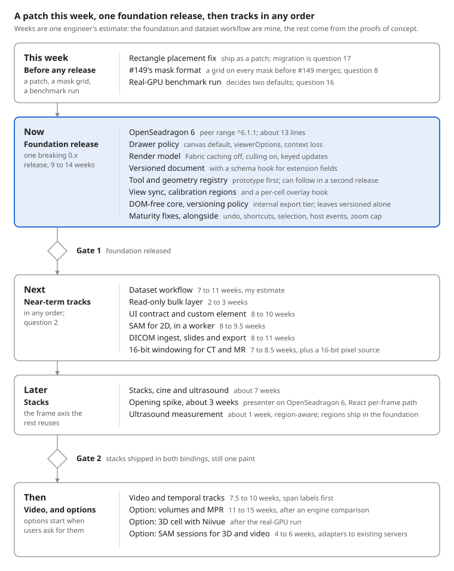
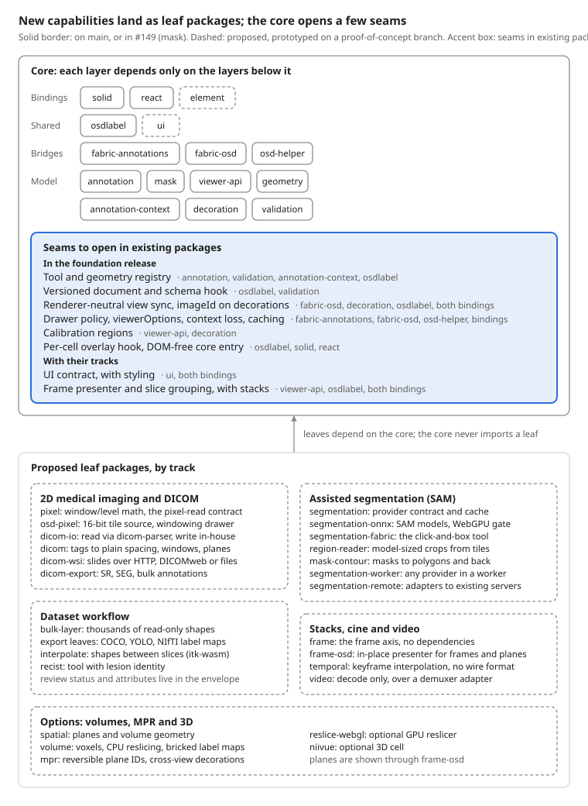

# osdlabel Roadmap: Strategy & Feasibility

Oct 23, 2026 · @Guy Or

The question: which directions can osdlabel take while keeping its composable, one-concern-per-package architecture, and in what order. Every verdict here rests on a measured proof of concept (a branch you can check out) or on cited research. The roadmap below was revised after an adversarial critique checked it against your brief and the evidence. A copy of every tab, with the diagrams, the full source list and an index of the branches, is committed under roadmap/ on the claude/osdlabel-roadmap-strategy-uut5ay branch.

## The roadmap

osdlabel should stay an annotation layer over one 2D viewport host, OpenSeadragon, rather than grow a rendering pipeline of its own. Each modality plugs its pixels in as a leaf package: a tile source (DICOM slides), a drawer subclass (16-bit windowing), or a frame source repainted in place (stacks, video, volume planes). Fabric keeps drawing editable shapes and the DOM keeps drawing decorations, unchanged. Every 2D proof of concept worked that way, and none needed a single rendering pipeline. Only true 3D brings a second renderer, Niivue, which drew annotations through its own overlay. A renderer-neutral projection contract is needed only for that cell, and it is not built yet.



### This week

Three things should not wait for any release.

- **Fix rectangle placement and ship it as a patch.** In Fabric 7, a rectangle's left and top place its centre unless an origin is set, and osdlabel's rectangle tool and geometry builder never set one. So every rectangle is painted centred on the corner its geometry records. The video build reproduced it in the Solid dev app: a drag from (272, 252) to (472, 402) painted a rectangle from (171, 176) to (372, 327). The geometry round-trips, so the tests pass, but anything computed from it lands half a rectangle away from what the user saw: labels, measurements, DICOM exports, SAM box prompts. Every release until it ships writes more rectangles that need migrating (question 17). The fix is ready on branch claude/fix-rect-origin, not merged: rectangles are built and read by their centre, so the geometry is exact whatever origin a saved Fabric object carries. Its unit tests, a new end-to-end placement test that reads the painted pixels, and both full end-to-end suites pass (162 passed, 1 skipped, on Solid and on React).
- **Give #149's masks their own grid before it merges.** Today a mask holds only full-resolution pixels under a 64 Mi-pixel cap, so neither the brush nor SAM can make a mask larger than about 2 mm square on a slide. Add a power-of-two downsample to every mask before #149 merges, since merging releases the format: 1.5 to 3 weeks (question 8, and the section on #149's mask format).
- **Run the GPU benchmarks on real hardware** (question 16). The run decides two defaults and when the volume and 3D options can start; it delays no committed track.

### The foundation release

One breaking 0.x release, because several items change public types, the serialized format or the OpenSeadragon peer range. Sizes are my estimates from the proofs of concept and the code; items marked unbuilt have no prototype.

| #   | Item                                                                                                         | Packages                                             | Breaks consumers | Size                                  | Evidence                                                                       |
| --- | ------------------------------------------------------------------------------------------------------------ | ---------------------------------------------------- | ---------------- | ------------------------------------- | ------------------------------------------------------------------------------ |
| 1   | OpenSeadragon 6.1.1, with the peer range at ^6.1.1                                                           | fabric-osd, osd-helper, bindings                     | Yes              | 2 to 3 days                           | 13 type-level lines; every test passed in a trial                              |
| 2   | Drawer policy: canvas drawer by default, a per-cell viewerOptions prop, replaceDrawer, context-loss handling | fabric-osd, osd-helper, both bindings                | No               | 1 to 1.5 weeks                        | replaceDrawer is 25 lines and viewerOptions about 20 per binding (pixel build) |
| 3   | Render model: Fabric caching off, offscreen culling on, keyed updates instead of rebuilds                    | fabric-annotations, fabric-osd, both bindings        | No               | 1 to 2 weeks                          | Caching and culling are one line each; keyed updates are unbuilt               |
| 4   | Versioned document with a schema hook for extension fields                                                   | osdlabel, validation                                 | Yes              | 1 to 1.5 weeks                        | Unbuilt (question 6)                                                           |
| 5   | Tool and geometry registry                                                                                   | annotation, validation, annotation-context, osdlabel | Yes              | A 1-week prototype, then 2 to 3 weeks | Unbuilt; #149's one tool touched 11 of 13 packages (question 7)                |
| 6   | Renderer-neutral view sync for decorations, and imageId on the decoration context                            | fabric-osd, decoration, osdlabel, both bindings      | No               | 0.5 to 1 week                         | +8 lines for imageId (volume build); the interface extraction is unbuilt       |
| 7   | Calibration regions                                                                                          | viewer-api, decoration                               | No               | 0.5 to 1 week                         | DICOM build estimate                                                           |
| 8   | Per-cell overlay hook in both bindings                                                                       | solid, react                                         | No               | 2 to 3 days                           | The bulk layer needed it (DICOM review)                                        |
| 9   | A DOM-free core entry and an internal export tier                                                            | osdlabel, both bindings                              | Yes              | About 1 week                          | Maturity item 10                                                               |
| 10  | Versioning policy: core in lockstep, leaves versioned on their own                                           | release scripts                                      | No               | 1 to 2 days                           | Question 18                                                                    |

That is about 9 to 14 engineer-weeks. The registry is the largest and least certain item; if it holds up the rest, it can follow in a second 0.x release. Whichever near-term track comes first, styling's slot names, part names and token names should join this release, so the rest of styling lands as additions rather than in a breaking release of its own (question 2). The maturity fixes 1 to 5 (undo, shortcuts, selection, host events, the zoom cap) run alongside, about 2 to 4 engineer-weeks, by my estimate from the audit's sizes (small for shortcuts and the zoom cap, small to medium for host events, small then medium for selection, medium for undo). None conflicts with the foundation, though the selection fix as planned uses its keyed updates, and the zoom-cap fix touches the same files as OpenSeadragon 6 and the drawer policy.

### Order and gates

Gate 1 is the foundation release. After it, the near-term tracks can run in any order: the dataset workflow, the bulk layer, styling with the custom element, SAM for 2D images, DICOM, and 16-bit windowing (question 2). They are independent once the per-cell overlay hook is in the foundation, except that windowing needs a 16-bit pixel source, which no estimate covers yet (question 9), and the dataset workflow's interpolation (1.5 to 2 weeks) and series labels wait for stacks. The real-GPU run gates two defaults and the start of the volume and 3D options. Windowing ships first on the CPU tile path, which needs no GPU, and moves to the shared-context GPU drawer only if the run supports it. Volume cells reslice on the GPU only if the run supports it.

Stacks open the later phase with a spike of about 3 weeks, inside their estimate: port the frame presenter to OpenSeadragon 6's tile invalidation and build React's per-frame path. Stacks continue only if pixels and annotations still land in the same paint in both bindings. If that fails on version 6, the fallback is a sliding window of two or three preloaded tiled images through OpenSeadragon's public API. Gate 2 is stacks shipped in both bindings, because ultrasound cine, video and volumes all reuse the frame axis and the in-place repaint.

Volumes and MPR, the 3D cell and SAM sessions are options, not commitments. Each starts only when users ask for it. Volumes and the 3D cell also wait for the real-GPU run, and volumes for one comparison: osdlabel's own reslicer against a borrowed volume engine (vtk.js, or Cornerstone3D's loader) and against Niivue as the MPR renderer.

### Capacity

The sized items add up to about 67 to 95 engineer-weeks before the options:

| Phase      | Items                                                                                                   | Engineer-weeks |
| ---------- | ------------------------------------------------------------------------------------------------------- | -------------- |
| This week  | Rectangle fix and migration, a grid on #149's masks                                                     | 2 to 3.5       |
| Foundation | The table above                                                                                         | 9 to 14        |
| Alongside  | Maturity fixes 1 to 5                                                                                   | 2 to 4         |
| Near term  | Styling and the element 8 to 10, SAM 8 to 9.5, DICOM 8 to 11, the bulk layer 2 to 3, windowing 7 to 8.5 | 33 to 42       |
| Near term  | Dataset workflow (my estimate, unbuilt)                                                                 | 7 to 11        |
| Later      | Stacks 5.5 to 9, ultrasound measurement about 1, video with span labels 7.5 to 10                       | 14 to 20       |
| Options    | Volumes and MPR 11 to 15, SAM sessions 4 to 6                                                           | 15 to 21       |

The masks and calibration weeks that the SAM and DICOM builds counted are moved to this week and the foundation, not counted twice, and the bulk layer is taken out of DICOM. Not sized at all: decoding CT and MR pixels, and the 3D cell beyond Niivue's adapter. With one maintainer the tracks run one after another, so the committed plan is about one and a half to two years. If capacity does not grow, the cut line falls after stacks, and video joins the options.

## Verdicts

Every direction you named is feasible without giving up the composition of OpenSeadragon, Fabric and the DOM. None of them needs a single rendering pipeline. What differs is how much has to change in existing packages first, and that is what orders the roadmap.

| Direction                  | Verdict                               | Deciding evidence                                                                                                                                                                                                                                                                                                                                                                                                                                                                                                                                                                 | Needs first                                                                                                                                                                                                                     |
| -------------------------- | ------------------------------------- | --------------------------------------------------------------------------------------------------------------------------------------------------------------------------------------------------------------------------------------------------------------------------------------------------------------------------------------------------------------------------------------------------------------------------------------------------------------------------------------------------------------------------------------------------------------------------------- | ------------------------------------------------------------------------------------------------------------------------------------------------------------------------------------------------------------------------------- |
| SAM-assisted annotation    | Go, near term                         | MobileSAM in a worker: a cold encode takes 2 to 9 s on CPU WebAssembly and a click 130 to 400 ms; cached clicks paint in 0.16 to 0.6 s. The worker keeps frame gaps under 0.25 s during an encode, against 5 to 7 s freezes on the main thread. Refinement after a zoom works (IoU 0.99 with the first mask). int8 on the matrix multiplications halves the encoder download (14.2 MB instead of 28.1) with near-identical masks. ViT-B takes 16 to 69 s, so it goes server-side                                                                                                  | A grid on #149's masks; a tool registry, or edits to 8 source files per tool                                                                                                                                                    |
| DICOM adapter              | Go, near term                         | Three leaf packages (reading with mapping, slides, export), 0 lines changed in existing ones; the plan splits reading from mapping, as the review advised. 103 of 103 real files parsed; SR, SEG and bulk annotation exports pass dciodvfy and read back in highdicom; slides streamed into the viewer over HTTP Range from a local server, and frames came over HTTP Range from IDC's public bucket in Node, without rendering or a CORS check (DICOMweb only against a local emulator)                                                                                          | Calibration regions (27 of 40 ultrasound files calibrate through regions, and 3 have several regions, where one pixel spacing would measure lines across panes); a public per-cell overlay hook. Both are now in the foundation |
| Styling and override slots | Go, near term                         | Prototype in both bindings: 19 design tokens, CSS parts, typed slots fed by one headless view-model. After its fix pass, every renderer must render every slot, and part selectors override the toolbar in light DOM                                                                                                                                                                                                                                                                                                                                                              | Moving seven more components from inline styles to the shared stylesheet                                                                                                                                                        |
| More frameworks            | Go, as one custom element             | Vue, Svelte, Angular and React 19 hosts pass the 28 host tests, and all 75 end-to-end tests pass, for 1.9 KiB gzip over the Solid binding                                                                                                                                                                                                                                                                                                                                                                                                                                         | Composed events and focus checks that work inside a shadow root (63 lines)                                                                                                                                                      |
| CT and MR windowing        | Go, after the drawer policy           | CSS filters show 6 grey levels in the brain window where windowing shows 80. On OpenSeadragon 5, tiled CPU windowing ran at 49 to 60 fps in a 1024×1024 viewer and stays above 30 fps up to about 4.5 megapixels drawn per frame. A 16-bit drawer subclasses OpenSeadragon's without a fork                                                                                                                                                                                                                                                                                       | The foundation release; a 16-bit pixel source (question 9). The GPU drawer becomes the default only after the real-GPU run                                                                                                      |
| Stacks and cine            | Go, after the foundation              | One cell repainting in place scrolled 50 to 53 slices/s with 10 annotations per slice and about 30 with 50, on the canvas drawer with Fabric object caching off (11 with caching on). Keying annotations by slice beat a frame field on edits and limits. Cine at 30 fps dropped 0 to 1.4% of frames                                                                                                                                                                                                                                                                              | Canvas drawer and caching off as stack defaults; a per-frame path in React; the presenter moved to OpenSeadragon 6                                                                                                              |
| Ultrasound                 | Go, as stacks plus calibration        | 27 of 40 sampled ultrasound files calibrate through regions, and 3 have several. M-mode and Doppler axes in seconds or cm/s were tested only on synthetic data                                                                                                                                                                                                                                                                                                                                                                                                                    | Calibration regions (in the foundation); a region-aware measurement provider (see Ultrasound)                                                                                                                                   |
| Video                      | Feasible, after stacks                | WebCodecs decoding was exact in 1,920 of 1,920 seeks and steps across H.264, VP9, AV1 and variable frame rates; a video element needs the demuxed timestamps to match it. Stored frame-start times resolve to the right frame for every writer tested; the element's current time does not. OpenSeadragon drawing each decoded frame directly stayed frame-locked at 34 to 35 fps for a 1080p60 source on the CPU, within 10% of a separate layer. Keyframes round-trip as ordinary annotations. 1,000 tracks interpolate in 0.2 to 1.9 ms per frame. No existing package changed | The frame axis from stacks; the versioned document's schema hook, so keyframe fields survive loading; a real-GPU run for 1080p60 playback                                                                                       |
| Volumes and MPR            | Feasible, an option after stacks      | CPU reslicing of a 512×512×400 CT while scrolling: about 2 ms axial, 5 ms coronal, 15 ms sagittal (6 ms from a sagittal-major copy). Four canvas-drawer cells scrolled axial and coronal at 44 to 51 fps; sagittal and oblique sat at about 31, and a linked three-plane crosshair at 21 (about 30 with the copy). Cross-view projection works as decoration providers, and plane IDs reload without a registry. Existing packages changed by 43 lines                                                                                                                            | The frame axis; a storage layout that makes sagittal and crosshair reslicing fast; a real-GPU run; the engine comparison                                                                                                        |
| 3D rendering               | Feasible, as an optional adapter cell | Niivue reads the same voxel buffer with no CPU copy and uses one context per page, but holds 3× the volume on the GPU (7× with its drawing layer, 8× with the shared WebGL reslicer as well). Annotations overlay within 1 px. Ray-casting speed is unknown on real GPUs                                                                                                                                                                                                                                                                                                          | Niivue 1.0 stable; a real-GPU run                                                                                                                                                                                               |

Every proof of concept has had its independent review. All but the pixel pipeline and DICOM also had a fix pass; for those two, the review's corrections were applied here by hand. The rows above are the state after them. The last three fix passes narrowed the evidence rather than overturning a verdict: volumes and MPR got lower frame rates, bricked label maps and a GPU memory cost; SAM's refinement after a zoom now works and int8 is adopted; video needs no separate video layer, and keyframes become ordinary annotations. Their timings come from a shared 4-core machine. A rerun on an otherwise idle machine reproduced the SAM numbers, then hit a time limit during video, so the other benchmarks keep their shared-machine timings. The real-GPU run (question 16) supersedes them where it matters.

Your hunch about OHIF is half right. The web does impose ceilings that bind any browser viewer, osdlabel included: 16 live WebGL contexts per page (8 on Android), 2 GiB per buffer until Chrome 157, 2,048 voxels per side for 3D textures, and no 64-bit WebAssembly memory on Safari. Cornerstone3D's large-volume failures (volumes of 0.4 to 4 GB) are mostly these, and osdlabel's 3D work would meet the same walls and need the same remedies: bricked storage and reslicing on demand. What Cornerstone3D adds on top is self-inflicted. Its minimal core bundle (38% vtk.js and 25% dcmjs by minified size) is 788 KB gzip, against 156 KB for OpenSeadragon plus Fabric in 2D and about 620 KiB even with the Niivue 3D cell. Its image and volume views all go through WebGL, so it needs a pool of 7 contexts and a copy per viewport. Composition avoids both on the CPU paths: 8-bit cells draw on a plain canvas with no context, and 16-bit cells can window on the CPU with no context (up to about 4.5 megapixels per frame). The other 16-bit option, one shared context for every cell, avoids the pool but copies each cell's frame out, as Cornerstone3D does. Whether 3D rendering is fast enough in a browser stays open until the real-GPU run.

The competitor that matters most is not OHIF. Niivue 1.0 now opens DZI slides with polygon drawing, has 16 vector annotation tools for volume slices, and ships React and Lit bindings and an OHIF extension, so it reaches into osdlabel's own niche. Annota (MIT; OpenSeadragon with PixiJS, React and Svelte) and Annotorious cover OpenSeadragon-based slide annotation and already draw bulk shapes with WebGL, and Annotorious ships a SAM 2 plugin. None of them has a time axis. So osdlabel should lead where they are not: its typed model, contexts and constraints, binding parity and the dataset workflow; close the scale gap early with the bulk layer; make time (stacks, then video) its differentiator; and treat volumes and 3D as integration with Niivue rather than a renderer of its own. With SAM it is catching up, not leading.

## Questions for you

These are the choices the evidence does not settle. Each one has my recommendation, and the rest of this roadmap assumes it until you say otherwise. Comment on a question to answer or overrule it.

### Direction

1. **Who is the primary user: teams building datasets, or clinicians reading studies?** I recommend dataset teams. They need undo/redo, review status, study and series labels, and export formats. All but series labels fit the model once the document is versioned; series labels need the series grouping that arrives with stacks. Clinical reading needs hanging protocols, longitudinal tracking and report packages, which belong in an app like OHIF. The answer orders the dataset workflow (see Near-term directions): whether calibrated measurement tools (RECIST, ultrasound calipers) come before segmentation with interpolation between slices.
2. **Which near-term track comes first?** Five tracks follow the foundation: the dataset workflow with the bulk layer, styling with the custom element, SAM for 2D images, DICOM, and 16-bit windowing. They are independent once the per-cell overlay hook is in the foundation, except that windowing needs a 16-bit pixel source (question 9), and the dataset workflow's interpolation and series labels wait for stacks. Without a signal I would start with the dataset workflow and the bulk layer, because they serve dataset teams (question 1), then SAM. If styling comes later, its slot, part and token names should still join the foundation release, so styling adds rather than breaks.
3. **Should React's stock Annotator become a thin wrapper over the custom element?** It would end the drift between two hand-written stock UIs (#152), but the costs are real. @osdlabel/react would depend on the element, and through it on @osdlabel/solid and solid-js: the first edge between the two bindings. The wrapper needs React 19, while @osdlabel/react supports 18. And the element does not server-render. I recommend leaving React's stock UI in place; if you want the experiment, publish the wrapper as a separate, React-19-only leaf and decide on its measured size, override ergonomics and how many hosts are still on React 18.

### Foundation changes that break consumers

4. **Upgrade to OpenSeadragon 6 now, as a breaking release?** I recommend yes. The code change is about 13 type-level lines and every test passes. The pixel pipeline and stacks lean on what version 6 adds (typed tile data, requestInvalidate); on version 5 they rely on two private internals. Moving the peer range to ^6.1.1 breaks consumers, which a 0.x release can absorb.
5. **Default drawer: canvas for every cell, or one shared WebGL context?** I recommend the canvas drawer as the default now. It uses no WebGL context and was the fastest drawer in every run, and panned a grid at 45 to 60 fps in the pixel review. A shared WebGL2 context would stay opt-in, for cells that show 16-bit data, until it is measured on a real GPU. Hosts can switch today by setting OpenSeadragon.DEFAULT_SETTINGS.drawer to 'canvas' (stock cells over volume planes went from 17 to 55 fps in the volume review), but that changes every OpenSeadragon viewer on the page, not only osdlabel's. Treat it as a stopgap until the foundation's per-cell viewerOptions prop.
6. **Version the serialized document?** I recommend writing an envelope, `{ format, version, annotations }`, still reading bare arrays, and adding a schema hook so extension fields survive deserialization. Today unknown fields are stripped silently, so any new field (review status, a video keyframe's frame reference, or a consumer's own extension) vanishes in an older reader instead of being refused. Does anyone rely on the untyped `metadata` field? The schema accepts it, but the type does not declare it.
7. **Open the tool and geometry types with a registry?** Adding the brush in #149 changed source in 11 of 13 packages; the SAM build added its tool with an injected list of tool factories plus one union member, in 8 source files. I recommend a registry, but it is unproven, so prototype it first: move the brush and the SAM tool onto it, aiming for one new package and no core edits per tool. Its shape matters. Types open by declaration merging: @osdlabel/annotation declares empty ToolTypeMap and GeometryMap interfaces that leaf packages extend, so ToolType stays a typed union for hosts. Runtime entries (factory, schema, constraint key, toolbar label, shortcut) are passed per instance, through a provider prop and a deserialize option, never held in a module-level singleton; that is what separates it from OHIF's global customization service, which this roadmap rejects. Unknown tool ids survive a load through the envelope's schema hook.
8. **Hold #149's merge until its masks carry their own grid?** Today a mask holds only full-resolution pixels, and its bounding box is capped at 64 Mi of them, so neither the brush nor SAM can make a mask larger than about 2 mm square on a slide. I recommend adding a power-of-two downsample to every mask before #149 merges, because merging releases the format: 1.5 to 3 weeks, depending on how much of the brush policy comes with it. The alternative is to merge now with the rule pinned (geometry in full-resolution pixels, a missing field meaning 1) and add the field later for 1 to 3 days, accepting a window in which older clients skip coarser masks. Either way, which brush policy: start at full resolution and coarsen on overflow (recommended), or keep the brush at full resolution for now? The section on #149's mask format, after these questions, has the detail.

### Near-term choices

9. **Pixels for CT and MR: decode DICOM in the browser, or a server that serves 16-bit tiles?** I recommend both behind one pixel-read contract (see the pixel-access row under Where the architecture holds), with browser decoding built first because it needs no deployed service. HTJ2K decodes a sub-resolution in 0.9 to 6 ms, which maps onto the tile pyramid. osdlabel would publish only the browser-side client and the contract; any tile server lives in examples. Decoding is not sized yet, and windowing waits on it.
10. **DICOM parser: in-house, or dicom-parser plus an in-house writer?** The in-house reader passed every file in the test set (103 files, 400 survey headers) at 5.4 KB gzip. The review showed dicom-parser's one failure was a harness artifact. I recommend dicom-parser for reading, since a parser's value is the odd files it has already met. The writer stays in-house, and CI checks its output with dciodvfy and highdicom for structure plus a TID 1500 template validator (PixelMed's DicomSRValidator or dcmqi), because those two passed five deliberate template violations.
11. **Default SAM model and where its weights live.** I recommend MobileSAM (Apache-2.0, real weights on npm) with its encoder quantised to int8 on the matrix multiplications only: 14.2 MB instead of 28.1, 20% faster on one WebAssembly thread, and masks within IoU 0.973 to 0.998 of fp32. Other int8 recipes damaged masks. osdlabel would not bundle weights: the host passes a URL and the browser caches them. Should osdlabel publish vetted ONNX exports itself? Exporting SAM 2.1 in this study failed in the browser runtime's shape inference, so someone has to curate them.
12. **Custom element: bundle solid-js inside it, or depend on it?** I recommend publishing both builds: an ES module that depends on solid-js (deduplicated with @osdlabel/solid) and a standalone bundle for a single script tag, about 191 KiB gzip judging by the fully bundled build in the proof of concept.

### Long-term choices

13. **Stacks: key annotations by slice, or put a frame on each annotation?** Measured on equal footing, one image ID per slice, grouped under a series that shares one frame axis, tied on scroll speed and won on edit cost, per-slice limits, file size and safety with older readers. I recommend it. A frame field on annotations gives series-level labels and a time on each annotation without extra work; choose it only if those matter more to your users than the costs in the Stacks section.
14. **Video: decode in the browser, or require frames extracted ahead of time?** I recommend both, through one frame-source contract. Browser decoding uses WebCodecs with mediabunny (MPL-2.0, used unmodified), the only demuxer measured; it read MP4 and WebM exactly. mp4box (BSD-3) reads MP4 only and was not tested; it is the fallback if MPL-2.0 is a problem for your users. mediabunny sits behind a subpath of @osdlabel/video as an optional peer, so replacing it means writing an adapter, not a rewrite. Is it? And does your ultrasound data arrive as DICOM cine or as MP4?
15. **May a published package depend on Niivue 1.0 while it is a release candidate?** Not yet. Nothing needs it before the 3D cell, which is now an option; revisit when that is scheduled, by when 1.0 may be stable. If it is still a release candidate then, pin an exact version in an optional adapter, never in a core package.

### Something only you can run

16. **Run the GPU benchmarks on a machine with a real GPU.** Every GPU number in this study comes from SwiftShader, a software renderer, on 4 CPU cores. Seven decisions wait on real hardware: the shared WebGL context, the GPU windowing drawer, 60 fps windowing, the WebGL reslicer, WebGPU for SAM, the 1080p video pixel path, and the 3D cell's rendering speed (the volume bench's Niivue section). None of them delays a committed track; the volume and 3D options start only after it, as Order and gates says. Each branch's REPORT.md has the full command; the short forms are:

```sh
git checkout claude/poc-pixel-pipeline && pnpm --filter @osdlabel/poc-pixel-pipeline bench --channel chrome --headed
git checkout claude/poc-frame-axis && pnpm --filter @osdlabel/poc-frame-axis bench --headed --channel chrome
git checkout claude/poc-volume && pnpm --filter @osdlabel/poc-volume bench -- --headed --chromium "/path/to/Google Chrome"
git checkout claude/poc-sam && pnpm --filter @osdlabel/poc-sam fetch-models && pnpm --filter @osdlabel/poc-sam bench -- --chromium "/path/to/Google Chrome" --headed --webgpu-models mobile_sam,sam2_tiny_real
git checkout claude/poc-video && pnpm exec turbo run build --filter=@osdlabel/poc-video^... && pnpm --filter @osdlabel/poc-video bench -- --only h2 --chromium "/path/to/Google Chrome" --headed
```

Run `pnpm install` and build the packages first, as each REPORT.md describes. The result files land under each app's `results/` directory; attach them to a comment here and I will fold them in.

### Raised by the proofs of concept and their reviews

17. **How should rectangles saved by current releases be migrated?** They store the rectangle's centre where their geometry says top-left corner (see The roadmap). With the fix, they keep painting where they did, and their geometry is corrected the first time they are edited, because it is now read from the shape's centre whatever origin the saved data carries. I recommend also migrating on load, so measurements and exports are right before anyone edits them: a rectangle whose stored geometry origin equals its Fabric data's left and top under a centre origin is an old one, so recompute its geometry from the Fabric object. The alternative is to keep the old meaning for old documents with a version flag, which the versioned envelope (question 6) would make possible.

18) **Version leaf packages on their own?** Today every package releases in lockstep, and CI enforces it. With about 27 more packages, churn in an experimental leaf (a Niivue pin, mediabunny, the ONNX runtime adapters) would force a release of everything, and a breaking change in one leaf would bump them all. I recommend keeping the core, from annotation to the bindings, in lockstep, and versioning leaves on their own, each with a peer range on the core; experimental leaves start at their own 0.x.
19) **Does the first DICOM release wait for real windowing?** The adapter derives window centre and width, VOI lookup tables, rescale and inversion, but nothing in osdlabel can apply them until the 16-bit windowing track ships; the prototype baked frames to 8-bit with the default window. I recommend shipping DICOM with a baked default window and saying so, so that slides, export and calibration are not held up.
20) **Window/level state: an absolute window per cell, or today's relative tone?** For 16-bit images I recommend an absolute window per cell (centre and width in modality units after rescale, HU for CT), with the standard presets (brain 80/40, lung 1500/−600 and so on) and the radiology drag: horizontal for width, vertical for level. Relative tone stays for 8-bit images.

## #149's mask format

\#149's masks can hold only full-resolution pixels, and every mask's bounding box is capped at 64 Mi of them. Together that means no mask, painted or from SAM, can be larger than about 2 mm square on a slide. The fix is to give each mask its own grid, a power-of-two downsample, before #149 merges, because merging releases the format. This section replaces the roadmap's earlier description, which was wrong in four places: the cap is not specific to SAM; re-encoding a finer crop at commit does not fix it; merging with the format marked experimental is not a separate option here; and the 1.5 weeks quoted was a line item written before anything was built. The measurements are in the Evidence tab under Mask format.

### What is wrong

- **A mask can only hold full-resolution pixels.** The mask geometry, the stored payload (`osdlabel-mask`), the paint buffer, both codecs, the document schema, the Fabric renderer and `area()` all treat one mask pixel as one full-resolution image pixel, and no field can say otherwise.
- **Every mask's bounding box is capped at 64 Mi full-resolution pixels.** Painting, decoding, rendering, export and the schema all enforce `DEFAULT_MAX_MASK_PIXELS` (67,108,864). A host can lower it but not raise it (open issue #155).
- **So no mask can be larger than about 8,192 × 8,192 full-resolution pixels**: 2 mm square at 0.25 µm per pixel, under 1% of a 100,000 × 80,000 slide. The cap is on area, so long thin strokes reach further.
- **The brush hits it, not only SAM.** Driving #149's own mask package the way the brush tool does, on a 100,000 × 80,000 image, the largest square that commits is 8,142 px a side, and a diagonal stroke with the largest brush (radius 512) is abandoned after 7,134 px on each axis. The whole stroke is dropped, silently unless the host handles `onCapacityExceeded`. At overview zoom that largest brush is about 5 CSS px wide on screen.
- **SAM hits it at overview zoom.** Two of the four overview steps exceeded it: S1 at 2.27 billion pixels (33.9×) and S4 at 1.0 billion (15×); S2 and S3 fitted. The prototype then committed only the largest outer ring. For S1 on the local runs that dropped 14 rings and 4 holes, although every one of them had already been traced.

### What is not wrong

- **Not the encoding.** #149's run-length payload writes S1 at full resolution in about 0.5 MB. What fails is that every path then holds the bounding box as one dense byte array, 2.27 GB for S1.
- **Re-encoding a finer crop at commit cannot help.** The stored box is the object's full-resolution box however finely it is segmented, and S1's object filled its whole encoded crop. It only sharpens edges.
- **Raising the cap barely helps.** An at-cap mask already renders as a 256 MiB canvas. Four times the cap is a 1 GiB canvas at Chromium's area limit, and moves the ceiling only from about 2 to about 4 mm.

### Options

| Option                                                                     | SAM's overview masks                                                                       | Painting large regions                                                     | Cost                                  | Verdict                                       |
| -------------------------------------------------------------------------- | ------------------------------------------------------------------------------------------ | -------------------------------------------------------------------------- | ------------------------------------- | --------------------------------------------- |
| A grid on every mask: a power-of-two downsample, cells stored on that grid | Fixed: S1 at downsample 8 kept all 15 rings and 4 holes, IoU 0.999 against full resolution | Fixed, with the brush policy below                                         | 1.5 to 3 weeks before #149 merges     | Recommended                                   |
| Polygons with holes and multiple parts                                     | Fixed                                                                                      | Only if the brush itself becomes vector, as QuPath's is: 3 to 4 more weeks | 2 to 2.5 weeks                        | Later, for hand-drawn regions                 |
| Sparse tiled storage at full resolution                                    | Fixed: S1 in 12 MB bit-packed                                                              | Fixed                                                                      | 12 to 18 weeks, with a render pyramid | Not now; possible later with no format change |
| Merge now, format marked experimental                                      | Not fixed                                                                                  | Not fixed                                                                  | Days                                  | Rejected: merging releases the format         |
| Raise the cap                                                              | Not fixed                                                                                  | Barely                                                                     | Days                                  | Rejected                                      |

### Recommendation

Do not merge #149 until each mask carries its own grid. Nothing is released yet: `@osdlabel/mask` is not on npm and 0.21.0 has no mask format. But merging releases it, because the next version PR carries #149's changeset, and recent ones published within hours (0.20.0 and 0.21.0 went out 71 minutes apart).

The format change, spiked on `claude/spike-mask-resolution` (one commit on #149; every unit suite in both bindings and the Solid brush E2E pass):

- **A downsample on every mask**, an integer power of two, 1 meaning today's full resolution. Powers of two match the Deep Zoom levels, so moving a mask between grids is lossless by replicating cells.
- **The box and geometry stay in full-resolution pixels.** Origin, width and height keep their meaning, aligned to the grid, and `pixelCount` stays the exact number of full-resolution pixels covered, so `area()` and the measurement decorations are unchanged. The payload holds ceil(width / d) × ceil(height / d) cells, anchored by their corners at the box origin. The convention has to be stated, because OME-Zarr places pixel coordinates at centres.
- **Older readers fail closed.** A missing field means 1, so today's payloads stay byte-identical, and a reader built from #149 rejects a coarser mask rather than misplacing it (checked on 33 payloads).
- **The cap counts cells and leaves the document schema**, becoming a decode and render budget, so a sparse store later needs no format change.
- **Cells get their own type in code**: the snapshot nests its cell box, so reading cells as image pixels fails to compile. A required field alone would not catch that.
- **The renderer scales cells by the downsample**, and refuses a canvas wider than the browser can draw instead of drawing it blank.
- **COCO export expands to full resolution in run space**: S1 at downsample 8 exports in under 0.3 s without allocating the full box. Import keeps a declared downsample instead of quietly resetting it to 1. `@osdlabel/mask` also exports a streaming full-resolution run iterator and a resample function, for exporters such as DICOM SEG and NIfTI.

Who picks the downsample:

- **SAM** takes it from the model's own cell size: the largest power of two under it, 128 for S1's 234 px cells. That keeps every ring and hole and loses nothing real. Two equally valid upsamplings of the same logits differ more from each other (IoU 0.987) than downsample 128 differs from full resolution (0.994), and it renders from a 0.5 MB canvas where downsample 8 needs 135 MB.
- **The brush** starts every mask at full resolution, as #149 does. When a stroke would overflow, it coarsens the mask 2×2 and keeps painting, with a notice, instead of dropping the stroke. When a later stroke at a closer zoom needs finer cells and they fit, it re-grids finer. The host can pin a minimum or maximum per annotation context, and above 1 the cursor shows the footprint snapped to cells. The spike's rule, choosing from the size of the view, was wrong: it coarsened small strokes, varied with monitor size, and kept masks begun zoomed out coarse when refined at 40×.
- **Import** keeps whatever the source declares.

Cost, with review of #149 (15,500 lines, not yet reviewed) as the real bottleneck:

- **1.5 to 2 weeks:** the format change, with SAM and import producing coarse masks and the brush still at full resolution.
- **2 to 2.5 weeks:** plus coarsening on overflow and re-gridding, so the brush can paint large regions.
- **2.5 to 3 weeks:** plus a brush radius that follows the zoom, as QuPath's does, so large regions are comfortable to paint.

If #149 must merge first, pin the rule now: geometry and box in full-resolution pixels, a missing field meaning 1, and a test that a coarser payload fails closed. Adding the field later then costs 1 to 3 days, plus a window in which older clients skip coarser masks and drop them when they re-save.

Fix these in #149 under any option: the capacity error tells users to raise `maxPixels`, which the API forbids; masks wider than 65,535 px are legal but render blank in Chromium, while the guide says such masks are skipped and reported; the guide calls the cap a guard for the pathological case, when any 2 mm region hits it; and it gives the live preview as 1.5× the box on each axis where the code uses 2× (issue #158), so an at-cap preview can need 2 GiB.

Later, and only when users need them: polygons with holes and multiple parts, with a vector region brush, for hand-drawn regions; and sparse storage at full resolution, for pixel-exact edits anywhere on a huge object.

### How others store masks

Whole-slide tools give a raster its own grid. A DICOM SEG may have its own spacing and extent (highdicom writes them, and the reference slide viewer displays them); OME-Zarr labels carry a scale and translation per level; 3D Slicer, napari and DSA's pixel maps carry their own geometry. Tools built for photos and video frames (COCO, CVAT, Label Studio) store full resolution with no scale, which is #149's model today. For large hand-drawn regions, whole-slide tools use vector polygons with holes: QuPath, DSA, Annotorious, Cytomine. DICOM's vector annotations cannot carry holes yet (Supplement 255 is a draft), so a region with holes leaves DICOM as a SEG.

## Where the architecture holds, bends and breaks

The package graph holds. Seven proofs of concept added 20 new packages, and none changed a dependency edge between existing packages. What bends is the data model and three render-time assumptions. Each has a bounded fix. Some were built and measured in the proofs of concept; the registry, the document envelope, the view-sync interface, the shared pixel-read contract and keyed diffing were not built, and the calibration size is an estimate. The reviews of the pixel, DICOM, stacks and element proofs of concept are folded in below; the volume, SAM and video reviews are folded in too.

| Seam                      | Today                                                                                                                                                                                                               | What stresses it (evidence)                                                                                                                                                                                                                                                                                  | Fix                                                                                                                                                                                                                                                                                                                         | Size                                                                                        |
| ------------------------- | ------------------------------------------------------------------------------------------------------------------------------------------------------------------------------------------------------------------- | ------------------------------------------------------------------------------------------------------------------------------------------------------------------------------------------------------------------------------------------------------------------------------------------------------------ | --------------------------------------------------------------------------------------------------------------------------------------------------------------------------------------------------------------------------------------------------------------------------------------------------------------------------- | ------------------------------------------------------------------------------------------- |
| Package graph             | 12 packages on main and 13 with #149's mask package, layered, no cycles; `annotation` and `mask` have zero dependencies                                                                                             | Frames: the stack prototype made osdlabel import @osdlabel/frame and the Solid binding import @osdlabel/frame-osd. Every other proof of concept added leaves only                                                                                                                                            | With per-slice IDs and the two frame-step helpers moved into osdlabel, osdlabel no longer needs the frame package. The bindings call an optional, structural presenter on the image source, which frame-osd implements, so frames ship as leaves                                                                            | Small                                                                                       |
| Tool and geometry types   | Closed unions repeated in about 10 packages                                                                                                                                                                         | PR #149 changed source in 11 of 13 packages to add one tool, so new tools cannot be leaf packages                                                                                                                                                                                                            | A tool and geometry registry keyed by string id, with today's tools registered                                                                                                                                                                                                                                              | Medium, one-time                                                                            |
| Saved document            | Bare array, no version; the validator silently drops unknown fields                                                                                                                                                 | Consumer extension fields on Annotation\<E> are already lost on load today. Any field a later release adds (review status, authorship, a frame reference on video keyframes) would vanish the same way in an older reader instead of being refused. Stacks keyed by slice ID add no field and are unaffected | Versioned envelope (still accepting the bare array) plus a schema hook for extension fields                                                                                                                                                                                                                                 | Small                                                                                       |
| Where an annotation lives | `imageId` plus 2D image-pixel geometry                                                                                                                                                                              | Stacks: today's cell reopens the viewer and resets its view whenever its image changes, so stacks need an in-place repaint. 3D needs plane geometry                                                                                                                                                          | Stacks: one image ID per slice, grouped under a series with a frame axis. Video: keyframes as ordinary annotations carrying a frame reference. 3D: plane image IDs that decode to their plane                                                                                                                               | Stacks: 21 files, +795/−71, all new core fields optional. 3D: 6 files, +43/−5               |
| One image per cell        | Changing a cell's image closes and reopens OSD and resets rotation and zoom                                                                                                                                         | Slice scrolling, cine, video                                                                                                                                                                                                                                                                                 | One tiled image whose single tile is repainted in place: 58 slices/s at 60 fps with the view kept                                                                                                                                                                                                                           | New leaf packages                                                                           |
| Pixel pipeline            | 8-bit tiles; tone is a CSS filter on the drawer canvas                                                                                                                                                              | CT brain window shows 6 grey levels instead of 80; DX and mammography windows show 38 and 17 of 256                                                                                                                                                                                                          | 16-bit tile source plus a window/level drawer, as a drawer subclass, without forking OpenSeadragon                                                                                                                                                                                                                          | +63 lines in `fabric-osd`                                                                   |
| WebGL contexts            | OpenSeadragon's default drawer takes one context per cell                                                                                                                                                           | A full 4×4 grid is at Chrome's limit of 16 (8 on Android). One more WebGL user blanks a cell on OSD 5, and makes OSD 6 thrash                                                                                                                                                                                | Canvas drawer for ordinary cells (0 contexts), or one shared context for all cells (1 context for 24 cells, measured)                                                                                                                                                                                                       | Small                                                                                       |
| Overlay coupling          | `DecorationLayer` takes the concrete OpenSeadragon overlay class                                                                                                                                                    | A renderer outside OpenSeadragon, such as the Niivue 3D cell, which drew annotations through its own overlay in the prototype. Video cells used the existing overlay unchanged; MPR cells added only a public viewer getter to it                                                                            | Extract the 4 members it uses into an interface                                                                                                                                                                                                                                                                             | Small, non-breaking; needed for the 3D cell                                                 |
| Calibration               | One `PixelSpacing` per image                                                                                                                                                                                        | 27 of 40 random public ultrasound images calibrate per region, 3 of 40 have several regions; M-mode and Doppler axes are time and velocity                                                                                                                                                                   | Optional `calibrationRegions` on `ImageSource`; `PixelSpacing` stays the simple case                                                                                                                                                                                                                                        | About 40 lines, plus about 80 for the region-aware measurement provider                     |
| Decoration inputs         | Annotations, spacing, selection                                                                                                                                                                                     | ROI statistics need pixel values; providers shared across cells need to know their cell                                                                                                                                                                                                                      | Optional pixel sampler and `imageId` on `DecorationContext`                                                                                                                                                                                                                                                                 | +8 lines for `imageId`                                                                      |
| Pixel access              | Five separate contracts across the prototypes: frame-osd's frame source, dicom-wsi's frame source, SAM's region reader (8-bit RGBA only), osd-pixel's 16-bit raster source, and a proposed decoration pixel sampler | CT stacks, SAM on CT and MR, ROI statistics                                                                                                                                                                                                                                                                  | One zero-dependency read contract in @osdlabel/pixel: width, height, levels, optional frames, and a read of a rectangle at a level that returns 16-bit grey or RGBA with its stored-value metadata. DICOM, frame, volume and video sources implement it; the drawer, the presenter, SAM's reader and the sampler consume it | Small, new types only                                                                       |
| Render model              | Every change clears and rebuilds all objects; Fabric caches every object                                                                                                                                            | 1,000 polygons: 0.2 to 1.4 s per pan or zoom frame in software rendering; about 10 ms or less with caching off                                                                                                                                                                                               | Caching off, offscreen culling back on (it is exact at osdlabel's 90° rotations), keyed diffing instead of rebuilds                                                                                                                                                                                                         | Small: caching in fabric-annotations, culling in fabric-osd, keyed diffing in both bindings |
| Scale                     | Every annotation is a Fabric object                                                                                                                                                                                 | 8,000 polygons: 2.3 s per frame. The tested nuclei set holds 55,000 shapes; IDC's 75th percentile is about 441,000                                                                                                                                                                                           | Read-only bulk layer with level of detail: 55,000 nuclei as dots in 2.9 ms; dense polygon views unmeasured                                                                                                                                                                                                                  | New leaf package                                                                            |

The render-model row is a bug at today's scale, not future work: it slows ordinary 2D annotation now. Its fix is in the foundation release. The scale row is needed before anyone imports bulk annotations, such as model predictions used as pre-labels, so the bulk layer is now a near-term track of its own rather than part of DICOM.

## Package graph



The graph stays layered and acyclic: every proposed package depends only on packages below it, and nothing in the core imports a leaf. The stack prototype broke that rule once, because osdlabel imported the frame package and the Solid binding imported the presenter. With slice-ID keying, and the two frame-step helpers it still uses moved into osdlabel, the first import goes away. The second becomes an optional presenter on the image source, which the bindings call and frame-osd implements, the way the SAM build injected its tool. The UI contract moves out of osdlabel into its own package, @osdlabel/ui, so osdlabel stays free of DOM and styling code. Under today's lockstep release policy every package still releases together; question 18 proposes versioning leaves on their own, so an app that uses only DICOM export can upgrade it without the rest.

The seams split by release. Six open in the foundation release; the box above lists them, and the foundation table under The roadmap sizes them. Two open with their tracks: the UI contract with styling, and the frame presenter and slice grouping with stacks. What the proofs of concept measured: imageId on decorations, a public viewer getter on the overlay and the decoration layer's skip for unchanged lines took +43/−5 in the volume build (the view-sync interface itself is unbuilt), the drawer seam 63, and calibration regions an estimated 40. Frames with slice grouping took +795/−71 across 21 files, about 100 lines fewer once the frame field is dropped. The UI contract took about 2,400, including 940 of tests. The registry and the document envelope were not built; without a registry, the SAM tool's registration took +17/−3 lines in 8 source files (+38/−5 across 14 files with tests).

## Near-term directions

Five tracks follow the foundation: the dataset workflow with the bulk layer, styling with the custom element, SAM for 2D images, DICOM, and 16-bit windowing (under Rendering below). SAM, DICOM, the bulk layer and the custom element fit as leaf packages with fewer than 70 changed lines in existing packages, and the dataset workflow's new fields ride the foundation's versioned document. Styling is different: its contract lives in a new `@osdlabel/ui` package that both bindings render from, and the prototype's changes to existing packages, mostly moving the toolbar, status bar and annotator shell onto it, came to about 2,400 lines including tests, and seven components remain. Question 2 asks which track comes first. The DICOM, element and SAM reviews are folded in below, with the element and SAM fix passes. The DICOM fix pass was skipped; this document carries its review's corrections.

### SAM-assisted annotation

Pursue it as a provider contract plus a tool. The library ships no weights and no server, and does not depend on a model runtime. #133's contract is superseded: it read pixels from the screen canvas, so overlays and rotation leaked into the embedding; it returned one polygon; and it cached per image. The proof of concept rebuilt the contract on #149 as seven leaf packages, changing existing code by +38/−5 lines. `@osdlabel/segmentation` holds the `SegmentationProvider` contract (`capabilities`, `prepare`, `segment`, `dispose`), the encode plan, and an embedding cache keyed by image, rendering variant, region and scale. `@osdlabel/region-reader` reads a region of the tile pyramid at model resolution. `@osdlabel/mask-contour` turns masks into polygons with holes. `@osdlabel/segmentation-onnx` adapts the models over an ONNX runtime the host injects. `@osdlabel/segmentation-worker` runs any provider in a worker, `@osdlabel/segmentation-remote` holds the client adapters to existing services, and `@osdlabel/segmentation-fabric` is the click and box tool. The independent review reproduced the coordinate pipeline bit for bit and the float16 result, and found three problems; the fix pass resolved them, and the list below is the state after it.

- **Where inference runs:** in a worker, on a crop of the current view read from the tile pyramid at model resolution, never from the screen. Embeddings are cached per image, rendering variant, region and scale, and an encode starts when the view settles. On a synthetic 100,000×80,000 slide, cached clicks painted in 0.16 to 0.6 s across runs. A cold MobileSAM encode took 2 to 9 s on CPU WebAssembly, depending on thread count and machine load, so encoding on settle matters.
- **Responsiveness:** in a worker, the longest gap between frames stayed at or below 233 ms during a cold encode; on the main thread each encode froze the viewer for 5.4 to 7.4 s. The worker still costs frames: 60 fps once tiles had settled, 31 to 50 while they loaded and 17 to 29 while panning, fewer with more threads. Two threads encoded as fast as four on 4 cores and cost fewer frames, so the default is half the cores. Most of the earlier slowdown while tiles loaded came from OpenSeadragon's WebGL drawer on the software GPU: with no inference at all it panned at 3 to 4 fps, against 43 on the canvas drawer.
- **Refinement after a view change works.** The encode covers the view plus the prompt's points, box and previous mask, and the previous mask is resampled onto the new encoding's grid before it is fed back. A click, a 4× zoom and a second click cost one re-encode, and the second mask matched the first at IoU 0.992 (0.984 against ground truth). Feeding the old mask back without resampling shifted it 556 px; dropping it left the top mask at 0.27.
- **Models and quantisation:** MobileSAM by default (Apache-2.0, real ONNX weights on npm). Ship its encoder quantised to int8 on the matrix multiplications only: 14.2 MB instead of 28.1, 20% faster on one WebAssembly thread, and masks at IoU 0.973 to 0.998 against fp32. Quantising every operator, or static quantisation, wrecked some masks (IoU down to 0.12 and 0.26), so the recipe matters more than int8 itself. The int8 decoder is 20% faster but swapped the best candidate once in 9 steps, so it stays an option. EfficientSAM-Ti is an option; SAM 2 tiny is for propagation through stacks and video; EdgeSAM is fast but non-commercial; SAM ViT-B took 16 to 69 s, so it belongs on a server.
- **What was refuted:** prompt decoding is not under 50 ms on CPU WebAssembly; it took 130 to 400 ms. Hover previews therefore need a real GPU or a server. WebGPU is used only when the adapter is real hardware and a short benchmark beats WebAssembly by 1.5×; the gate rejected this sandbox's software fallback, which was 40 to 150× slower. WebGPU on a real GPU is unmeasured.
- **One contract, three topologies:** an in-browser worker; a server that encodes while the browser decodes (a 2 MiB float16 embedding per encode, with masks identical to float32); or everything on the server. osdlabel ships no server and defines no inference protocol of its own. A remote topology is a client adapter to an existing service, written against the `SegmentationServiceAdapter` contract; MONAI Label and nnInteractive mappings are sketched from their source and were tested only against a fake service. The float16 wire format stays optional, and neither the worker nor the remote package depends on ONNX.
- **Output:** a #149 mask by default, with polygons as an option. At overview zoom a SAM mask spans up to 2.3 gigapixels, 34× the mask package's cap, and the prototype's fallback kept only the largest ring (dropping 14 rings and 4 holes in S1's local runs, although all had been traced). With a grid on masks, the tool commits at the model's own cell size and keeps every ring and hole (question 8). Re-encoding a finer crop at commit does not help: the box stays the same.
- **Not answered: medical images.** The region reader reads 8-bit RGBA only, the test images are synthetic, and the one medical model ran with random weights, so in-browser SAM on CT or MR is unproven. It needs the 16-bit pixel source and a decision on which window the encoder sees.
- **Also needed:** a way to cycle through SAM's candidate masks. On the ambiguous clicks, the top-scored mask picked the lumen over the gland.
- **Effort:** 8 to 9.5 engineer-weeks for 2D: about 2 to harden the contract, region reader and contour packages, 2 for the ONNX package, 1 for the worker and remote packages with one real adapter (MONAI Label) tested against a running server, 2.5 for the tool in both bindings with parity tests and candidate cycling, and 1 for docs. The grid on masks belongs to #149 (question 8). A stateful session contract for propagation (SAM 2 video, MedSAM2, nnInteractive) adds 4 to 6 once stacks land; it is one of the options.

### DICOM adapter

Pursue it as leaf packages split by concern. The proof of concept changed zero lines in any existing package. Reading is separate from mapping, so a host that already has a parser, or gets DICOM JSON from a DICOMweb server, does not pull one in.

- **Packages:** `@osdlabel/dicom-io` reads Part 10 and DICOM JSON and writes Part 10. `@osdlabel/dicom` maps a minimal `DicomDataset` interface to plain osdlabel values and has no parser dependency: `toImageSources`, `derivePixelSpacing`, `toCalibrationRegions`, `deriveDisplayDefaults`, `readFrameTiming`, `readPlaneGeometry`, and a `DicomImageIndex` from image IDs back to their source. `@osdlabel/dicom-wsi` opens slide pyramids with `createWsiTileSource` over pluggable frame sources (Part 10 files, HTTP Range, DICOMweb). `@osdlabel/dicom-export` writes and reads SR, SEG and microscopy bulk annotations, taking its measurement math from `@osdlabel/geometry`. The prototype kept reading and mapping in one package and took the math from `@osdlabel/decoration`; the split follows the review. Rendering frames to pixels belongs to the pixel pipeline, not to these packages.
- **Ingest:** dicom-parser for reading plus an in-house writer (recommended; question 10). The prototype's in-house package, reader, writer and mapping together, is 14 KB gzip (the reader alone 5.4 KB; dcmjs is 193 KB), and it mapped 103 of 103 public files correctly against pydicom, covering CT, MR, ultrasound, DX, mammography and slide microscopy. dicom-parser was first rejected for failing on a truncated header, but that failure was a harness artifact: it reads the file in header mode. Its reader is only 2 KB larger and has years of field use. The mapping derives spacing, windows, inversion, cine timing and plane geometry as plain, DICOM-free values.
- **Windowing:** window centre and width, VOI lookup tables, rescale and MONOCHROME1 inversion are derived (`deriveDisplayDefaults`), but nothing in osdlabel can apply them until the 16-bit pixel pipeline ships (see Rendering). Until then the prototype's CPU stand-in (renderNativeFrame) renders uncompressed frames to 8-bit with the default window baked in, at a median of 0.75 ms per CT frame and 25.9 ms per DX frame. It throws on compressed pixel data, so compressed images wait for browser decoding (question 9). Shipping it is an exception to keeping rendering out of these packages, until the pixel pipeline replaces it. I recommend shipping DICOM like that rather than waiting (question 19).
- **Whole-slide images:** DICOM WSI opens in OpenSeadragon through a tile source written as a plain object, so the package never imports OpenSeadragon. In the browser, frames came from local Part 10 files, HTTP Range requests to a local server, or a local DICOMweb emulator; no real DICOMweb server was tested. HTTP Range against IDC's public bucket was probed from Node only, with no rendering and no CORS, at a median of 69 ms per frame. The unmodified Annotator annotated them end to end.
- **Export:** SR (TID 1500), SEG from #149 masks (CT and ultrasound; a whole-slide SEG from masks was not built), and microscopy bulk annotations all passed dciodvfy with zero errors, and highdicom read them. Neither tool checks the SR template itself: five deliberate template violations also passed. A template-level validator is needed before claiming TID 1500 conformance. SR geometry and 2D bulk annotations round-trip within 5×10⁻⁴ px (2×10⁻⁵ px for CT, MR and ultrasound). 3D bulk annotations stored as float32 slide millimetres drift up to 4×10⁻³ px, and float64 brings that to 6×10⁻¹² px. Masks round-trip exactly.
- **What it surfaced for the core:** per-region ultrasound calibration, an optional `calibrationRegions` field on the image source (see Ultrasound), and a read-only bulk layer, since 8,000 polygons as Fabric objects took 2.3 s per frame in software rendering (see Bulk layer below). Both reach the core through the foundation release: calibration regions, and the per-cell overlay hook that the prototype could only reach through a test-only hook.
- **Effort:** 8 to 11 engineer-weeks: 2 to 3 for reading and mapping, 2 to 3 for slides, 3 to 4 for export, and 1 for docs. The bulk layer (2 to 3) is its own track and calibration regions (0.5 to 1) are in the foundation, so neither is counted here. Browser decoding of CT and MR pixels is not sized; it belongs with the pixel pipeline (question 9).

### Styling and component slots

Pursue a three-layer contract in a new package, `@osdlabel/ui`: the design tokens, part names, stock stylesheet and its adoption, shadow-root helpers, slot map and headless view-models. Both bindings and the element import it, so they render from the same view-models; the stock markup is still written once per binding. The prototype kept the contract in `osdlabel`. Moving it out keeps `osdlabel` free of DOM concerns (the foundation's DOM-free core entry), at the cost of one new package.

- **Design tokens:** CSS custom properties (--osdlabel-accent and 18 more), each falling back to today's value, so nothing changes until a host sets one. Four are reserved for components not yet converted.
- **Part names,** each with a class twin (osdlabel-tool-button) and state as extra names (tool-button-active). They work through ::part() in the element's shadow root. In light DOM they work only once the stock styles leave inline style attributes. The fix pass moved the toolbar's styles into one shared stylesheet, and host overrides by part or class then worked in Solid, React and the light-DOM element (3 of 3, against 0 before). The sheet is built once per document and adopted rather than appended to the page head, so it also survives a strict style-src Content Security Policy. It should ship unlayered: inside a cascade layer, Bootstrap's reset overrode 15 toolbar properties and an unlayered Tailwind reset 51, against 1 for today's inline styles and for an unlayered sheet. Nine components still use inline styles: the seven not yet tokenized, plus the status bar and annotator shell, which read tokens through inline styles. Moving all nine to the sheet also ends the 34 policy violation reports that Solid's compiled style attributes raise per mount.
- **Typed override slots:** each is backed by a headless view-model in @osdlabel/ui that the stock component itself renders from. \<Annotator components={{ Toolbar: MyToolbar }}> is type-checked in both bindings, and the element exposes the same slot as a named \<slot>. Each renderer now declares an exhaustive slot table. Adding a slot to the shared map fails the type check in Solid, React and the element until all three render it, which the fix pass confirmed by mutation.

The inventory shows why this matters. The two bindings hold 76 and 59 hard-coded colour literals (the same 18 colours), and 32 Solid-only and 29 React-only style declarations, the drift #152 warned of. The prototype tokenized the toolbar, status bar and annotator shell; seven components remain. The review raised a bigger lever: make React's stock Annotator a thin wrapper over the custom element, so there is one stock UI to maintain. The React provider and hooks would stay as the headless tier. That is a decision for you; it is in Questions for you.

### More frameworks

Ship one custom element, `<osdlabel-annotator>`, built from the Solid binding, instead of new Vue, Svelte or Angular bindings.

- **Coverage:** plain HTML, Vue 3.5, Svelte 5, Angular 22 and React 19, each binding the element with its own syntax. All 75 end-to-end tests pass, including decoration providers set after mount, which is what Angular does. The element costs 1.9 KiB gzip over the Solid binding, and its mount takes 0.2 to 0.6 ms longer than the Solid binding's.
- **Shadow DOM is the default it recommends.** Under Bootstrap or Tailwind, shadow DOM let only inherited properties through, on 42 of 128 elements; light DOM let all 127 change. Light DOM reached interactive 5 to 20% sooner in 4 of 4 runs, for a reason not yet found: mount cost differs by at most 0.5 ms.
- **Rules it settled:** structured inputs are properties and scalars are attributes. A host write whose image, id and updated time match the current annotations is treated as an echo, so a host edit must bump updatedAt. That check now runs before any copying, which made the echo 10 to 20× cheaper at 1,000 to 10,000 annotations. Every structured property stays live after mount.
- **Fixes it forced, which help any embedding:** forwarded pointer events must be composed, and keyboard and focus checks must look through shadow roots (63 lines). It also fixed two binding bugs on its branch: Solid read decoration providers only once, and React's toolbar commands read a stale closure.
- **The React and Solid bindings stay** as the deep-integration tier (hooks, composition, and server rendering in React).
- **Effort:** 8 to 10 engineer-weeks for the element and the full styling contract together. The prototype changed existing packages by about 2,400 lines, including 940 of tests, mostly the toolbar moved onto the shared view-model and stylesheet in both bindings.

### Dataset workflow

This is the track question 1 points at: what teams building training data need beyond drawing. It has no proof of concept. The scope comes from the clinical-workflow research and the code audit, and the estimates are mine. Each item is a leaf package or a field in the versioned document. Series labels and interpolation wait for stacks, a later track, so about 2 to 2.5 of these weeks cannot land in the near term; the rest can ship in any order.

- **Review state and authorship:** an annotation status (draft, submitted, reviewed, rejected) with a reviewer and `createdBy`, plus an `attributes` bag validated by a per-context schema, all carried in the versioned document. The audit sized attributes, review state and authorship together as large. About 2 to 3 weeks.
- **The `metadata` field:** the schema accepts it but the type does not declare it (question 6). Reconcile it in the foundation release, before anyone stores review data in it. A few days.
- **Study and series labels:** labels on a group of images rather than on a shape. Study labels fit the model once the document is versioned; series labels reuse the series grouping that arrives with stacks. About half a week beyond what stacks carries.
- **Export codecs as leaves:** COCO with RLE masks, YOLO, and a NIfTI label map first; CVAT XML and MOT for tracks later. An exclusive label map needs an explicit overlap rule (overwrite by z-order or by label priority, as in Slicer), the same rule DICOM SEG LABELMAP needs. #149's demo already writes COCO RLE, but pycocotools reads a whole-slide mask back only while its column-major offset stays under 2^32 pixels, so slide datasets need COCO images per tile or per level. About 2 to 3 weeks for the first three.
- **Interpolation between slices:** a worker leaf wrapping `@itk-wasm/morphological-contour-interpolation` (1.16 MB), outside `@osdlabel/mask`, so a team paints a few slices and fills the rest, as Slicer, Cornerstone and MONAI Label do. It needs stacks. About 1.5 to 2 weeks.
- **RECIST:** a long-axis and short-axis tool plus a decoration provider, with a lesion ID that persists across time points. It needs calibrated measurement, which the foundation's calibration regions provide. About 1 to 1.5 weeks.
- **Later:** a consensus utility (IoU matching and majority vote; STAPLE for masks as an optional server-side step) and span labels in time (see Video).
- **Effort:** 7 to 11 engineer-weeks in all. Segmentation is what public datasets mostly need: in a keyword count of 326 curated imaging datasets, 60% are segmentation, including 84% of the CT sets and 94% of the MR sets. So I would do review state and export first, then interpolation as soon as stacks ship.

### Bulk layer

Model predictions, cell detections and imported pre-labels arrive by the tens of thousands, and every annotation today is a Fabric object. In the DICOM prototype, 8,000 nucleus polygons as Fabric objects took 2.3 s to draw a frame at fit in software rendering and 4 s to mount, with about 373 MB of used heap. A read-only companion canvas on the overlay, with a 256-pixel grid index and shapes drawn as dots below 4 screen pixels, drew all 55,092 nuclei of an IDC slide in 2.9 ms at fit and 0.65 ms at 8× zoom, all of them as dots at both zooms.

- **Package:** `@osdlabel/bulk-layer`, DICOM-free: typed-array geometry, a grid index, level of detail, hit-testing, and promoting a shape to an ordinary annotation for editing. It mounts through the foundation's per-cell overlay hook and follows the view through the overlay's sync callback, so it needs no WebGL context of its own; Annota and Annotorious use a PixiJS context instead.
- **Found along the way:** Chromium's `Path2D.closePath()` is quadratic over many subpaths, and so is the context's own closePath(). 16,000 polygons took 9.9 s, against 24 ms when each ring is closed with `lineTo`, so the layer closes rings by hand.
- **Exit criterion:** measure the dense-polygon view, which the prototype did not: zoomed in far enough that thousands of shapes are drawn as outlines rather than dots, while panning. IDC's 75th-percentile annotation group holds about 441,000 shapes, eight times the tested set.
- **Effort:** 2 to 3 engineer-weeks. In my order it comes first after the foundation, because it serves dataset teams and closes the gap where the OSD-based competitors are ahead.

## Maturity and polish

A code audit of main found gaps that a dataset team or a host app will hit before any new modality matters. There is no undo, moving a shape deselects it, shortcuts ignore modifier keys, and the Solid binding reads several props only once. Items 4, 5 and 10 lean on foundation work (the viewerOptions prop, keyed updates, and the DOM-free core entry with its internal tier); the rest need none of the larger roadmap work. Three items are small, four are medium, and three are small to medium. I checked the main claims against the code myself.

| #   | Gap                      | What the code does today, and the fix                                                                                                                                                                                                                                                                                                                                                                                                                                                                                                                                                                                                                                                                                                                      | Size                                         |
| --- | ------------------------ | ---------------------------------------------------------------------------------------------------------------------------------------------------------------------------------------------------------------------------------------------------------------------------------------------------------------------------------------------------------------------------------------------------------------------------------------------------------------------------------------------------------------------------------------------------------------------------------------------------------------------------------------------------------------------------------------------------------------------------------------------------------- | -------------------------------------------- |
| 1   | Undo and redo            | There is no history at all, and Delete or Backspace removes the selection at once. Fix: record the inverse of each action in the shared reducers, one entry per gesture, with a transaction API, and expose undo and redo in both bindings                                                                                                                                                                                                                                                                                                                                                                                                                                                                                                                 | Medium                                       |
| 2   | Keyboard shortcuts       | The mapper sees only the key and Shift, and listens on the whole window. So Ctrl or Cmd+C switches to the circle tool, Cmd+Backspace deletes, and two annotators on one page both react. Tooltips hard-code the default keys. Fix: bindings with modifiers (Mod+Z), listening on the annotator, and the event passed to the host's filter                                                                                                                                                                                                                                                                                                                                                                                                                  | Small                                        |
| 3   | Events for hosts         | Every change sends the whole annotation list, including the host's own load echoing back. There are no create, update, delete or selection events and no veto. Solid reads the decoration providers, pixel spacing and fullscreen target once, where React keeps reading them (the element branch already fixes decoration providers); neither binding documents which props are read only at mount. Fix: typed events emitted from the shared action layer (create, update and delete, each with the previous value and a source, so a host can ignore its own load), selection and active-image events, an optional veto before a change, and Solid props read through getters, with a parity test and a stated live-or-mount rule per prop              | Small to medium                              |
| 4   | Whole-slide readiness    | Zoom stops at 40× the fitted size, which overrides OpenSeadragon's pixel-ratio limit: a 100,000-pixel slide in a 1,000-pixel cell never reaches native resolution. OpenSeadragon options cannot be overridden (tile retries default to 0, no minimap). A failed image shows only OpenSeadragon's own message. Fix: OpenSeadragon's pixel-ratio limit (about 2 to 4) instead of the 40× cap, the foundation's viewerOptions prop for the rest, and an image-error event plus a styled error state in the cell                                                                                                                                                                                                                                               | Small                                        |
| 5   | Selection                | Every edit rebuilds the canvas, which clears Fabric's selection, so moving a shape deselects it. Selecting from state never reaches the canvas, and a multi-selection reports as none. Fix: the foundation's keyed updates stop the rebuild, so the selection survives an edit; then push selection from state to the canvas, and later hold a list of selected IDs in state (breaking, since the decoration context changes)                                                                                                                                                                                                                                                                                                                              | Small, then medium for multi-select in state |
| 6   | Hit-testing and stacking | Fabric hit-tests against bounding boxes, and drawing tools ignore presses on any shape of the active context: in that context a point cannot go inside a polygon's or a diagonal line's box. There is no z-order. Fix: exact hit-testing per geometry with @osdlabel/geometry (distance to a segment within a screen-pixel tolerance, point in polygon), smaller areas on top by default, and bring-forward and send-back actions; define the hit-test hook so the registry can adopt it                                                                                                                                                                                                                                                                   | Medium                                       |
| 7   | Accessibility            | The toolbar has no toolbar role or pressed state, and its buttons lack type="button", so inside a host form a tool click submits it. The grid popover is mouse-only. The active tool's colour has 3.1:1 contrast. The overlay swallows OpenSeadragon's keyboard pan and zoom, and there are no zoom buttons. Fix: toolbar roles, pressed state, key hints from the shortcut map and type="button"; a keyboard-operable popover and a labelled select; block only the keys shortcuts use; zoom and home buttons; a labelled group per cell; darker default colours; and axe checks in the end-to-end suite. Drawing by keyboard is a separate, larger step                                                                                                  | Medium                                       |
| 8   | Errors and scale         | Deserializing rejects a whole document and drops which record failed. Adding an annotation with an existing id silently overwrites it. Spreading one image's annotations into a call threw at 150,000 items on Node 22 and worked at 100,000. Fix: issues that name each failing record's path, a lenient mode that skips invalid records and returns them, a result from adding an annotation that reports a duplicate ID, and loops instead of spreads with a 200,000-item test                                                                                                                                                                                                                                                                          | Small                                        |
| 9   | Strings and locale       | 41 hard-coded English strings per binding, 8 more in the core, measurements formatted without a locale, and only physical left/right CSS. Fix: a typed messages prop with English defaults, designed with the styling slots; a locale for measurement formatting; and logical CSS properties                                                                                                                                                                                                                                                                                                                                                                                                                                                               | Medium                                       |
| 10  | Release hygiene          | The core cannot be imported under Node or server rendering, because it re-exports @osdlabel/fabric-osd, which imports OpenSeadragon, and OpenSeadragon needs a document at import. osdlabel exports 205 names including binding internals, every file is importable, and there is no internal tier or deprecation policy. 82 of 280 exports have no documentation, among them Annotator, Toolbar, ViewerCell and the tool classes. End-to-end tests run on Chromium only, and some docs links are broken. Fix: the DOM-free core entry and an internal tier checked by an API report (both in the foundation), no wildcard exports, documentation required on every export by lint, a link validator in the docs build, and Firefox and WebKit smoke tests | Small to medium each                         |

Smaller items from the audit, not in the table, each a few days: hide and lock as unsaved UI state, nudging with the arrow keys once selection survives edits, duplicate and paste, an action that updates an annotation's geometry and regenerates its Fabric data (today a geometry-only patch moves the measurements but not the shape), a minimum count in constraints with a satisfied status so a context can say an image is complete, and lazy filmstrip thumbnails.

What is already good, for balance: teardown is thorough and tested in both bindings, stale asynchronous rebuilds are cancelled, the filmstrip is accessible, every package is side-effect free, a failing annotation is reported without breaking the rest, releases are lockstep with provenance, and both bindings run the same end-to-end suite offline.

Three items wait on the foundation: attributes, classes, review status, comments and authorship need the versioned document; copy and paste across shape types needs the registry; and a saved z-order needs the versioned document.

I recommend running items 1 to 5 alongside the foundation release, because they are what a dataset team notices in its first hour and none of them conflicts with the foundation work.

## Stacks and cine (CT/MR series, ultrasound loops)

Pursue, as two concerns. Pixels and navigation: one image source per series with a frame axis, repainted in place in a single cell. Annotations: one image ID per slice, grouped under the series, with no new field on annotations. The first build put a frame reference on each annotation instead. Once the review made the comparison fair, per-slice IDs tied or won on scrolling, edits, limits, file size and deserializing, though serializing 3,000 annotations took 34 ms against 21 ms. Built this way, the Solid cell scrolled a 300-slice stack at 50 to 53 slices/s with 10 annotations per slice and kept the user's zoom and rotation. Every new core field is optional.

### The model

- **The series:** one ImageSource carries a frame axis (spatial or temporal: a count, and optional keys, times and positions) and a frame source that paints any frame. It takes one grid assignment, and the view survives scrolling.
- **Annotations:** each slice has its own image ID, listed on the series. For DICOM that is the SOP Instance UID, plus a frame number for multi-frame files. New annotations take the shown slice's ID. The annotation schema, validation and serialized format do not change, so older readers keep stacks intact.
- **Still to build:** annotations that belong to the whole series and show on every slice, and a per-series limit. A frame field on annotations would give both directly, plus a time on each annotation. It stays the fallback if those matter more than the costs below (question 13).

Both keyings, measured in the real Solid binding with the same presenter (medians of 5 runs, first pass over the stack):

|                                             | Frame field on annotations                               | One image ID per slice |
| ------------------------------------------- | -------------------------------------------------------- | ---------------------- |
| Scroll, 10 per slice                        | 52.8 slices/s                                            | 50.5 slices/s          |
| Scroll, 50 per slice                        | 29.2 slices/s                                            | 31.2 slices/s          |
| Scroll, 200 per slice                       | 12.3 slices/s                                            | 13.8 slices/s          |
| One edit, 50 and 200 per slice              | 83 and 407 ms                                            | 69 and 207 ms          |
| Scroll with a per-slice limit, 50 per slice | 0.3 slices/s                                             | 30 to 32 slices/s      |
| Serialized size                             | 5% larger                                                | baseline               |
| Older readers                               | Strip the frame and show every annotation on every slice | Unaffected             |

### Pixels and annotations, painted together

The cell keeps one OpenSeadragon tiled image and repaints its single tile in place. The viewport never moves, so the overlay stays exact: 0 px drift. A step takes one display frame (16.8 ms median) and holds about 120 MB for a 300-slice stack. Opening a new image per slice, which is what today's cell does, managed 0.3 slices/s with a blank paint per step. Keeping 300 images and toggling their opacity was as fast but took 429 MB.

Annotations are rebuilt for each slice and drawn in the same paint as its pixels: 0 out-of-step paints in 225 recorded passes. Two settings make it fast, and both are now public options of the binding: the canvas drawer, and Fabric's per-object caching turned off. With caching on, 50 annotations per slice scrolled at 11 slices/s instead of about 30. The WebGL drawer on the software GPU managed 8 slices/s at 10 per slice. The prototype's object cache with look-ahead lost to plain rebuilding in every pass and used more memory at 10 and 50 per slice, so it goes.

| Annotations per slice | Display rate | Slices per second |
| --------------------- | ------------ | ----------------- |
| 0                     | 59 fps       | 58                |
| 10                    | 55 fps       | 53                |
| 50                    | 34 fps       | 33                |
| 200                   | 12 to 14 fps | 11 to 13          |

Scrolling a second time over the same slices, in the Solid binding, medians. At 200 per slice, decorations (about 9 ms) plus the swap and the render overrun a frame on this loaded 4-core machine.

### Cine

In the standalone harness, stepping on the display's own frame timestamps, an 800×600 loop with live annotations dropped 0 to 1.4% of frames at 30 fps on every canvas-drawer path, including WebCodecs decoding. At 60 fps, pixels held in memory dropped 0.7 to 4.3%; WebCodecs dropped 5.7 to 11% and a video element 45%. Frame times must come from the container: assuming a nominal rate put pixels and annotations out of step in 231 of 300 frames. The binding has no play control yet, so cine was measured outside it.

### Cost and prerequisites

- **New packages:** `@osdlabel/frame` (the frame axis; no dependencies, since annotations carry no frame reference) and `@osdlabel/frame-osd` (the presenter; OpenSeadragon as a peer). Both are leaves. Stacks open an optional, structural presenter seam on the image source, which the cell calls when a source has one, so no core package imports either (the frame-presenter seam in the package graph). The prototype wired the Solid cell to the presenter directly, and osdlabel's frame reducers, which per-slice IDs keep, took their clamp and step helpers from @osdlabel/frame. The wiring becomes the seam, and osdlabel needs its own copy of those two helpers.
- **Existing packages:** 21 files, +795/−71 in the prototype, of which the Solid cell is +453/−55. The new core fields are all optional: per-cell frame state, frame shortcuts and slice IDs. With per-slice IDs, about 100 lines of annotation-side changes drop out. Both end-to-end suites pass (172 passed, 1 skipped).
- **Opening spike, the first 3 weeks:** the presenter uses tile-cache hooks that OpenSeadragon 6 deprecates, and React is not built; it needs an imperative per-frame path, because asynchronous commits could bring out-of-step paints back. So the track opens by porting the presenter to version 6's tile invalidation and building React's per-frame path, then measuring whether pixels and annotations still land in one paint in both bindings. If they do not, the fallback is a sliding window of two or three preloaded tiled images through OpenSeadragon's public API, toggled by opacity. Preloading all 300 slices that way scrolled as fast but took 429 MB, about 1.4 MB per slice, so a short window costs little memory; whether it keeps up with fast scrolling is unmeasured.
- **Series labels:** the series grouping, a per-series scope and series-level display are in the estimate, in a 1.25-week item that also covers per-cell frame state and counting off the store proxies. The dataset workflow's series labels and per-series limits build on them.
- **Constraint counting:** recounting through Solid's store costs 200 to 400 ms per edit at 60,000 annotations, in either model. The cost predates stacks; stacks expose it, and the estimate includes counting off the store proxies.
- **Effort:** about 7 engineer-weeks (5.5 to 9), the spike included.

## Ultrasound

Pursue it as calibration plus cine, both small. One pixel spacing per image cannot carry ultrasound calibration. In a survey of 40 random IDC ultrasound instances, 27 calibrate through the ultrasound region sequence and 3 have several regions. A contrast-enhanced study had two side-by-side panes with identical spacing, so a single spacing would happily measure a line across both, which means nothing. M-mode and spectral Doppler axes are time and velocity, not length.

- **Calibration regions:** `ImageSource.calibrationRegions?: readonly CalibrationRegion[]` in viewer-api. Each region is a rectangle with an `AxisCalibration { perPixel, unit, quantity }` per axis, where the quantity is length, time, velocity, frequency or other. `PixelSpacing` stays as shorthand for one region covering the image. About 40 lines, in the foundation release.
- **Region-aware measurement:** the stock measurement provider measures only when every handle lies in one region, reports each axis in its own unit (a Doppler line reads seconds and cm/s), and falls back to pixels across regions, as Cornerstone does. The DICOM prototype did this as a wrapper with 4 unit tests; it labelled a real ultrasound line 10.01 mm and refused cross-region lines. About 80 lines in `@osdlabel/decoration`.
- **From DICOM:** `@osdlabel/dicom`'s `toCalibrationRegions` maps the region sequence. The prototype stores each delta as an absolute value and drops the reference pixel, so a Doppler velocity axis loses its direction; production must keep the sign and the baseline, since Doppler velocity runs both ways from it.
- **Cine:** through the stacks frame axis, timed from Frame Time or the Frame Time Vector, never an assumed rate; the prototype read 9.00128 fps from Frame Time where Cine Rate said 9. MP4 loops come through `@osdlabel/video` (question 14). A multi-frame ultrasound is not always cine: the 227-frame Eigen file is a spatial sweep, which its frame increment pointer says.
- **Labels in time:** ED/ES-style datasets trace two frames per clip. Those are ordinary annotations on the two frames' slice IDs; span labels come with video.
- **Not resolved:** projection radiographs have two defensible spacings, the detector's and the magnification-corrected one (ERMF), which 17 of 40 mammograms and 33 of 40 XA images carry. Calibration regions have no plane field, so a label cannot yet say "mm (detector)"; pixel spacing needs a basis or description for that. The sample had no real M-mode or Doppler instance, so time and velocity axes are covered only by synthetic tests. Test them on real IDC instances before calling this done.
- **Effort:** about 0.5 to 1 week for calibration regions (in the foundation) and about 1 week for the measurement provider and its tests, my estimate from the prototype's line counts. Cine is part of stacks.

## Video

Pursue, after stacks, as one more frame axis rather than a new renderer. Video frames are a temporal axis on the same kind of image source as stacks, and OpenSeadragon stays the host. Keyframes are ordinary annotations; interpolation goes in one leaf package and decoding in another, over WebCodecs. The build and its fix pass changed no existing package. The independent review reproduced the frame-accuracy results and found three problems; the fix pass resolved them, and the text below is the state after it.

### Frame-accurate access

- **WebCodecs is exact.** Through `@osdlabel/video`'s frame source over a mediabunny demuxer, it gave the right frame in 1,920 of 1,920 seeks and steps. The test set was 12 synthetic videos: H.264, VP9 and AV1; 720p and 1080p; 30 fps, 29.97 fps and a variable rate; keyframes every 1, 30 or 250 frames; with and without B-frames.
- **A video element is exact only with help.** Seeking to frame i / fps was exact 62.6% of the time (30 to 33% at 29.97 fps); stepping by 1/fps from a frame boundary, 23%. Seeking to (i + 0.5) / fps was exact 97.1% of the time, missing only on variable-rate video. Seeking to the midpoint of each frame's demuxed timestamps was exact in 1,440 of 1,440, but that needs the same demux WebCodecs needs, and a one-frame step then took 42 to 1,092 ms against 0.5 to 5.2 ms with WebCodecs. `requestVideoFrameCallback` is reliable: once a harness timer was fixed, it fired on 6,240 of 6,240 seeks and named the frame on screen every time.
- **Random access depends on keyframe spacing.** Backward steps and random seeks are bound by the keyframe interval on both paths, up to 0.3 to 1.5 s (median) with keyframes 250 frames apart. A 64-frame cache made backward steps free, because one decode from a keyframe fills it; the cache is the win there, not the decoder.
- **Store the frame's start time, never the element's current time.** A keyframe's time is the frame's start timestamp in integer microseconds, and a stored time resolves to a frame with at-or-before(t + min(1 ms, a quarter frame)). Over 13 videos and every writer tested, that rule was wrong 0 times for frame-start writers and for demuxed midpoints, 0 of 6,240 times for the browser's frame-callback times after seeks and 1 of 480 after pauses, and 4 to 7% of the time for times inside a frame. Nearest-frame lookup was wrong for 3,211 of 4,200 midpoints, and plain at-or-before for up to 2,280 of 4,200 millisecond-truncated starts. A video element's current time is not a frame identity: after a pause, the frame on screen started after it in 288 of 480 samples, and every rule failed 33 to 62% of the time. Writers store the frame callback's media time or the demuxed start instead.

### Showing frames with annotations

OpenSeadragon stays the host for the viewport, gestures, coordinates, the overlay and decorations. Only where the pixels come from changes:

| Pixel path, 1080p source at 60 fps, 50 tracks, 100 decorations     | Frame rate     | Overlay in step with the frame          |
| ------------------------------------------------------------------ | -------------- | --------------------------------------- |
| OpenSeadragon canvas drawer drawing each decoded frame directly    | 34 to 35 fps   | 100% of screenshots, fast pans included |
| A canvas under the overlay, fed by WebCodecs                       | 35.5 to 38 fps | 100%                                    |
| OpenSeadragon canvas drawer copying each frame into its tile first | 24 to 25 fps   | 100%                                    |
| OpenSeadragon WebGL drawer (software GPU)                          | 4 to 6 fps     | 100%                                    |
| A video element under the overlay, placed with CSS                 | 53 to 55 fps   | 8 to 25%; 1 to 4 frames behind          |

Drawing the decoded frame straight into OpenSeadragon's canvas, instead of copying it into a tile first, removes a second 1080p copy and closes most of the gap to a separate canvas layer: about 10% when static and within the noise while panning, with both always in step. So OpenSeadragon stays the host and the presenter draws frames directly; no separate video layer or compositor is needed, and the presenter lives in `@osdlabel/frame-osd` beside the stacks presenter. A video element under the overlay is faster only because nothing keeps it in step. No path played 1080p at 60 fps on this CPU-only machine, with the main thread 96 to 100% busy, so headroom waits for a real-GPU run, and decoding may need to move to a worker. The direct draw relies on OpenSeadragon 5's canvas drawer reading only the tile context's canvas, which the move to version 6 must re-check. DOM decorations are not free here: 100 of them cost 6 to 7 ms per frame including style and layout (2.3 ms of it in script), about 40% of a 60 fps budget, so playback needs them throttled or hidden. That is untested.

### Tracks

- **The model:** a track is an ID plus keyframes. Rectangles, circles, points and lines interpolate linearly, and rotation takes the shorter arc. Polygons and polylines interpolate through a vertex correspondence computed once per keyframe pair. Masks hold the nearest keyframe's pixels. Visibility is visible, occluded or outside, as in CVAT.
- **Keyframes are ordinary annotations.** Each keyframe is an annotation in today's state carrying a track ID, a frame reference and a visibility, and tracks are derived on load by grouping. The store, reducers and serializer then apply unchanged, and undo, once built, covers keyframes too. Validation needs the two additions below. The fix pass built it: 1,000 tracks with 10 keyframes each round-tripped exactly through osdlabel's serializer (0 of 300,000 samples differed). It costs more than a separate track document: 14.8 MB of JSON against 4.1 MB (1.6 against 1.2 MB gzip), and 181 against 49 ms to validate. 59% of that size is the Fabric payload every annotation carries, about 900 bytes per vector keyframe, which a slimmer keyframe payload could cut. I recommend it over a separate document format, which would duplicate the schema, versioning, mask handling, undo and actions.
- **What the core needs for it:** a keyframe field schema in `@osdlabel/validation`, and a `deserialize` option that takes an extension-field schema, because today's deserializer strips unknown fields (the prototype re-validated them in a 36 ms second pass). The foundation's schema hook is that option. Constraints must count tracks, not keyframes.
- **Cost for 1,000 tracks:** 0.18 ms per frame for rectangles, 0.49 ms for mixed shapes and 1.85 ms for polygons whose vertex counts differ between keyframes (warm medians). The first time playback enters a keyframe span, its correspondences are computed at once, up to about 100 ms in one frame, so they should be computed when keyframes are edited.
- **Why correspondence matters:** interpolating polygons vertex by vertex shrank the midpoint area to 0 for a redrawn polygon and to half for a shifted start vertex. Aligned, the area stayed within 1%.
- **Span labels and single-frame labels first.** Video datasets are mostly labelled sparsely in time: surgical phases as time spans, labels on sampled frames, two traced frames per echo clip. A span label is an annotation with a start and an end frame reference and a label, drawn as a bar on the same timeline. Today every annotation must carry a geometry, so span labels also need optional geometry in the core model or a non-spatial geometry type. A label on one frame is an annotation scoped to that frame, not a one-keyframe track. Both should ship before tracks; neither is built.
- **With the stock tools:** 15 substantive checks passed using the existing rectangle tool and Fabric dragging. The one failure is the rectangle-placement bug, which the interpolation check missed at first because it compared stored geometry rather than pixels.

### One frame model for stacks and video

- **One frame axis** in `@osdlabel/frame`, spatial or temporal, with times in integer microseconds and exact frame rates. It answers two questions: which frame is on screen at time t (at or before t), and which frame a stored time names (the tolerant lookup above).
- **Different keys, for a reason.** Stacks key annotations by slice image ID, because DICOM already names every slice. Video frames have no names, and tracks interpolate between keyframes, so keyframes carry a frame reference (an index and its start time) instead.
- **One OpenSeadragon presenter.** The stacks presenter, the video frame drawer and the volume build's canvas-backed tile source are the same concern, so all three live in `@osdlabel/frame-osd`.

### Cost

- **New packages:** `@osdlabel/temporal` (interpolation, correspondence, visibility and grouping; no wire format of its own) and `@osdlabel/video`, decode-only over a six-member `Demuxer` interface, with a WebCodecs frame source and a byte-bounded frame cache. mediabunny is an optional peer behind a `@osdlabel/video/mediabunny` subpath, limited to MP4 and WebM: 58 KB gzip with the core, against 92 KB with every format. mediabunny's own sample reader was exact but 3 to 840× slower per forward step (median about 125× over 12 videos; 3× only with a keyframe on every frame), so the hand-written decode loop stays. mp4box.js would be a second adapter and is untested. Existing packages: 0 lines in the prototype; making keyframes first-class needs the two small core changes above, about 30 to 50 lines.
- **Effort:** 6.5 to 9 engineer-weeks, of which 3.5 to 4 are the timeline, keyframe and visibility actions and per-frame rendering in both bindings. Span and single-frame labels add about a week by my estimate.
- **Risks:** render numbers are CPU-only, and no path reached 1080p at 60 fps here. The direct draw and the WebGL texture re-upload lean on OpenSeadragon internals. Firefox and Safari codec coverage and their current-time behaviour were not tested. Only synthetic, closed-GOP files were tested, and long files need demuxing on demand instead of all at once. mediabunny is MPL-2.0 and moves fast. Masks are held, not morphed, between keyframes.

## 3D volumes, MPR and 3D annotation

An option, by composition, after stacks: start it when users ask for MPR. Each plane of a volume becomes an ordinary image in today's 2D pipeline, and a volume model, pure 3D geometry and an embedded renderer (Niivue) do the rest. The proof of concept changed existing packages by +43/−5 lines. The independent review cut back its frame rates, its label-map comparison and its GPU memory claim; the fix pass re-measured all three on a machine with no other benchmark running, and the text below is the state after it.

### Reslicing into ordinary cells

A 512×512×400 CT-like volume (200 MiB, stored per slice) reslices on the CPU, while scrolling, in about 2 ms axial, 4.6 ms coronal and 15.4 ms sagittal (95th percentile 29 ms). Sagittal walks memory against the grain, and the fix pass confirmed on the quiet machine that the cause is the access pattern, not contention. A sagittal-major copy of the volume brings it to 6.2 ms, for 200 MiB more memory and 1.1 s to build. An oblique plane with trilinear interpolation takes about 14 ms, or 9 ms across 4 workers. Each plane is painted into a canvas-backed tile. Four cells on OpenSeadragon's canvas drawer, which uses no WebGL context, measured (median, with the range over three runs):

| Interaction, four cells                           | Frames per second                                          |
| ------------------------------------------------- | ---------------------------------------------------------- |
| Pan and zoom                                      | 60                                                         |
| Scroll axial                                      | 51 (43 to 59)                                              |
| Scroll coronal                                    | 44 (42 to 49)                                              |
| Scroll sagittal                                   | 31 (27 to 33); 39 (31 to 51) with the sagittal-major copy  |
| Rotate an oblique plane                           | 31 (25 to 32); 35 (27 to 42) with 3 workers                |
| Linked crosshair, three planes resliced per frame | 21; 31 (25 to 31) with the copy                            |
| Scroll axial with 518 annotations                 | 23.5 re-running every provider; 44 with memoised providers |

So axial and coronal planes are interactive on the CPU, sagittal and oblique are borderline, and the linked crosshair misses unless the storage serves every view. A tiled or bricked scalar layout, a worker pipeline drawing into an OffscreenCanvas, and a GPU reslicer on real hardware are all unmeasured remedies. Decorations need care at this scale: re-running every provider each frame cost 18.6 ms at 518 annotations, against 3.2 ms with providers memoised per cell and the decoration layer skipping lines it has already applied, an 8-line change the prototype made. An optional GPU reslicer takes one WebGL context shared by all cells. OpenSeadragon's WebGL drawer ran at 6 to 18 fps on the software GPU and needs a private API to refresh a tile on version 5. With that default drawer, 20 stock cells left 4 blank; with the canvas drawer, set page-wide as a stopgap, 20 cells used no context at all and ran at 38 fps.

### Annotations consistent across views

- **Geometry:** `@osdlabel/spatial`, with zero dependencies, holds plane geometry in the DICOM convention (origin plus row and column directions), plane cuts and reference lines.
- **Rendering:** cross-view projections, crosshairs and reference lines are plain decoration providers. The decoration types are unchanged; the additions are an optional `imageId` on the decoration context, so a shared provider knows its cell (8 lines), and the skip for unchanged lines above. With real tools driven by the mouse, all 13 cross-view checks passed on both drawers. A rectangle drawn axially appeared as a segment in coronal and sagittal with its ends on the rectangle's edges (within 0.01 px); a point drawn on coronal appeared as an axial marker; an oblique cell's segment mapped back onto the rectangle.
- **Storage and plane IDs:** annotations stay 2D in their own plane, keyed by a plane image ID that encodes the plane: `vol:<series>:axial:200` for a grid slice, and the quantized origin, directions, spacing and size for any other plane. An ID decodes back to its plane with no registry, so saved oblique annotations reload, and re-encoding a decoded plane gives the same ID. Planes are written out in full only at export (DICOM SR, SEG). Frames reached by different code paths could straddle a rounding boundary, so hosts derive planes through one path.
- **Label maps:** sparse 32³ bricks at runtime, with #149's per-slice masks as the export format. In the fair comparison, a dense volume, per-slice masks and bricks all painted within noise (0.02 to 0.1 ms per stamp), and masks and bricks displayed at parity with a lazily committed dense volume (a committed one was 2.5 to 3.2× slower sagittally), so the build's speed ratios are withdrawn and the choice is structural. Bricks give constant-time voxel access from any plane, memory that follows what is painted (3.0 MiB against a fixed 100 MiB for dense), and no per-slice reallocation. A dense array is kept only where a renderer needs one: Niivue's drawing layer.

### The 3D view

Niivue 1.0 (a release candidate, BSD-2) ran in one grid cell beside three osdlabel cells. It took the volume buffer without a CPU copy and used one WebGL context. It shared the label map as views over its own drawing buffer, and showed annotations through an SVG overlay within 1 px, without depth occlusion. The costs are on the GPU: Niivue alone holds 3.0× the volume (a scalar texture plus a gradient texture), 4.0× with the shared WebGL reslicer beside it, and 8.0× with its drawing layer, 1.68 GB for a 200 MiB volume. WebGL cannot share textures across contexts, so with a 3D cell on the page, 2D cells should reslice on the CPU. Add release-candidate churn, and a left-right mirroring to correct (Niivue uses RAS, DICOM LPS). Rotation ran at about 1 fps on the software GPU, which says nothing about real hardware.

### One model with stacks

The stacks fix pass settled the shape both builds share: pixels and navigation through one image source with a frame axis, repainted in place, and annotations keyed by one image ID per slice. The volume build keys annotations by plane ID, so it fits unchanged. Each orientation of a volume (axial, coronal, sagittal, or one oblique) becomes one image source whose frame axis runs along the plane's normal, and each slice's ID decodes to its plane. Volumes then get the same navigation, single grid assignment and in-place repaint as stacks, and keep the volume build's projection math. The combination itself has not been run.

### Cost

- **New packages, one concern each:** `@osdlabel/spatial` (plane and volume geometry, no dependencies), `@osdlabel/volume` (voxels, CPU reslicing, permuted copies and bricked label maps; depends only on spatial), `@osdlabel/reslice-webgl` (the optional GPU reslicer, no OpenSeadragon), `@osdlabel/mpr` (plane IDs and cross-view decoration providers) and an optional `@osdlabel/niivue` adapter. The prototype's canvas-backed tile source joins `@osdlabel/frame-osd`. The earlier sketch of a `volume-osd` package mixed three of these concerns and is split.
- **Existing packages:** 6 source files, +43/−5: `imageId` on the decoration context, a public viewer getter on the overlay, the decoration layer's skip for unchanged lines, and the image ID passed through both bindings, with parity tests in both.
- **Effort:** 11 to 15 engineer-weeks after the frame axis, excluding a DICOM series adapter and real-GPU tuning.
- **Before starting:** compare this reslicer with a borrowed volume engine (vtk.js, or Cornerstone3D's loader) feeding osdlabel cells, and with Niivue as the MPR renderer, as Order and gates says.
- **Risks:** / GPU paths are unmeasured on real hardware. / Sagittal and crosshair speed on the CPU need a better storage layout. / Volumes over 2 GiB cannot sit in one buffer in Chrome 156, so they need per-slice or brick storage, and 3D textures stop at 2,048 per side. / Niivue's GPU memory multipliers. / Cross-view providers read other cells' annotations through closures, which only Solid's tracking re-runs: the decoration context needs an accessor for other images' annotations, and a spatial index per plane at scale. / What an annotation drawn on an oblique plane belongs to: brush strokes there need a slab at least one voxel diagonal thick, or they leave holes.

## Rendering pipeline under load

OpenSeadragon can stay the 2D renderer for every modality tested, including 16-bit CT and mammography, without a fork. Two habits must go: windowing with CSS, and letting each cell take its own WebGL context.

### High bit depth

Today's tone control cannot window CT. A CSS filter acts on tiles already quantized to 8 bits, so a narrow window stretches a handful of grey levels. Grey levels visible inside each standard CT window:

| Window (width / level) | Correct 16-bit windowing | Best possible from 8-bit tiles |
| ---------------------- | ------------------------ | ------------------------------ |
| Brain 80 / 40          | 80                       | 6                              |
| Subdural 200 / 75      | 200                      | 14                             |
| Abdomen 400 / 50       | 256                      | 27                             |
| Lung 1500 / −600       | 196                      | 74                             |
| Bone 2000 / 300        | 256                      | 129                            |

Within osdlabel's current tone bounds the brain window is off by up to 129 grey levels. Two working replacements were built:

- **GPU drawer.** A drawer class for OpenSeadragon 5.0.1 keeps 16-bit tiles as textures and applies window/level in a shader. It plugs in as a subclass of OpenSeadragon's drawer base, without a fork, though on version 5 it also reads two undocumented internals. Dragging window/level uploads no textures and costs 0.07 to 0.39 ms of JavaScript per step with a context per cell. Sharing one context added a synchronous copy per cell (35 to 64 ms on the software GPU). With smoothing off, its output matches OpenSeadragon's own drawer on all but 0.07% of pixels. With smoothing on, 12% differ, because it interpolates stored values before windowing, which is the correct order. The overlay stayed registered in 296 of 296 checks. It ran on OpenSeadragon 6.1.1 after a port of about 190 lines, for the per-cell context only.
- **CPU tile path.** It re-windows only the tiles on screen: 8.9 ms per step for a 4096×3328 mammogram at 1:1. It holds 30 fps up to about 4.5 megapixels drawn per frame, roughly a 1024×1024 cell on a high-density display. Separately, windowing a 512×512 CT slice through a lookup table took 0.7 ms in the platform research and 4 ms in the pixel proof of concept, which also writes the canvas; decoding the slice from HTJ2K took 3.4 ms.

The GPU path's frame rate is unproven here: the sandbox's GPU is a software emulator. A run on real hardware decides which path is the default. The independent review also caught that this drawer drops tone (invert, exposure, contrast) on ordinary 8-bit tiles. So it must not become the default for 8-bit grids until its shader applies tone too.

### The WebGL context budget

Browsers keep a fixed number of live WebGL contexts per page and evict the oldest beyond it: 16 in desktop Chrome and in Safari (iOS included), 8 in Android Chrome, 300 per origin in Firefox (1,000 in all). osdlabel's cells each take one, so a full 4×4 grid is at the limit. Hosts can already go past it: the 4×4 cap only applies to keyboard shortcuts.

- **OpenSeadragon 5 (today):** 17 to 24 cells leave 1 to 8 cells blank for good. In osdlabel's own dev app, a single extra WebGL context blanked a cell.
- **OpenSeadragon 6:** above 16 viewers, its new context recovery thrashes: 24 viewers created 960 extra contexts in 20 redraws. Its WebGL drawer also opens grids slower: 16 viewers took 3.7 s against 0.7 s.
- **Measured ways out:** the canvas drawer uses no context and was the cheapest drawer here. One shared context drawing every cell held 1 context for 24 cells. A page-wide canvas with per-cell clipping also used 1, but draws outside each cell's DOM, so it is opt-in only.
- **A bug found on the way:** switching a cell's drawer at runtime blanks it, because the new canvas lands below osdlabel's overlay (15 of 15 cells). A 25-line `replaceDrawer` fixes it. Nothing in OpenSeadragon or osdlabel handles a lost context today.

### Memory

- **Volumes must be stored per slice or brick.** Chrome 156 caps one buffer at 2,046 MiB; Chrome 157, due Nov 3, is expected to raise that to about 16 GiB on 64-bit systems.
- **The 3D cell multiplies memory.** Niivue holds 3.0× the volume in GPU memory (a scalar texture plus a gradient texture), 4.0× beside the shared WebGL reslicer, and 8.0× once its drawing layer is on: 1.68 GB for a 200 MiB volume.
- **Fabric's object caching is the largest avoidable cost found.** On a 300-slice stack at 10 annotations per slice, with the prototype's object cache, it used 1,180 MB, against 318 MB with caching off.

### What to do

- **Now, in the foundation release:** upgrade to OpenSeadragon 6.1.1; it is 13 type-level lines, and every existing test passed in a trial run. Make the canvas drawer the default for ordinary 8-bit cells, add a per-cell `viewerOptions` prop so a host can choose the drawer and other options per cell instead of setting `OpenSeadragon.DEFAULT_SETTINGS` for the whole page, land `replaceDrawer`, and handle context loss.
- **Next, 16-bit windowing (7 to 8.5 weeks on OpenSeadragon 6, plus a 16-bit pixel source):** ship `@osdlabel/pixel` (pure window/level math) and `@osdlabel/osd-pixel` (the 16-bit tile source and window/level drawer), starting on the CPU tile path, which needs no GPU. On OpenSeadragon 6 that path has only been run through requestInvalidate, at 52 to 73 ms per step for a 512×512 CT against 2 to 5 ms on version 5, so a faster route on version 6 has to be built and measured first. Window state becomes an absolute window per cell, a `VoiWindow` of centre and width in modality units after rescale (HU for CT), with the standard presets and the radiology drag; relative tone stays for 8-bit images (question 20). The 16-bit pixel source, browser decoding of CT and MR pixels (question 9), is not sized yet, and this track waits on it.
- **After the real-GPU run:** the run decides only whether the GPU drawer with one shared context becomes the default (a context per cell stays for single-viewer pages), and for 8-bit grids only once its shader applies invert, exposure and contrast. It does not hold the track up.

## Rejected or deferred

Each rejection below rests on a measurement or a verified fact, not on taste. The biggest one is the monolithic renderer. Every proof of concept composed with OpenSeadragon, Fabric and the DOM, and needed between 0 and 63 changed lines in existing packages for pixels, DICOM, SAM and the 3D cell, and about 870 for stacks.

### Rejected

| What                                                                                            | Why                                                                                                                                                                                                                                                                                                                                               |
| ----------------------------------------------------------------------------------------------- | ------------------------------------------------------------------------------------------------------------------------------------------------------------------------------------------------------------------------------------------------------------------------------------------------------------------------------------------------- |
| A custom rendering pipeline that draws every view, annotation and overlay (Cornerstone3D style) | Composition worked everywhere it was tried: 16-bit windowing, stacks, MPR, a 3D cell, DICOM slides, SAM. Cornerstone3D itself is moving to a renderer per data type behind one coordinate contract                                                                                                                                                |
| CSS filters as window/level for CT or MR                                                        | 6 grey levels instead of 80 in the brain window; within osdlabel's tone bounds, errors up to 129 levels                                                                                                                                                                                                                                           |
| One WebGL context per cell as the long-term design                                              | Chrome and Safari keep 16 live contexts per page (8 on Android Chrome; Firefox allows 300 per origin). A full 4×4 grid already blanks a cell when anything else uses WebGL, and OpenSeadragon 6 thrashes above 16 viewers                                                                                                                         |
| Hand-written Vue, Svelte and Angular bindings                                                   | One custom element served all three, plus React 19, for 1.9 KiB gzip; the two existing bindings already drift (#152)                                                                                                                                                                                                                              |
| DICOM-shaped annotations, or DICOM fields on core types                                         | A host-side map from image to DICOM context carried everything export needed. Plain osdlabel geometry round-tripped to SR within 5×10⁻⁴ px and to SEG exactly                                                                                                                                                                                     |
| dcmjs as the core DICOM dependency                                                              | 193 KB gzip against 5.4 to 14.2 KB, and 12 to 244× slower header parsing than the in-house reader (10 to 33× in the review's rerun). At most an optional, lazily loaded export helper                                                                                                                                                             |
| Thousands of read-only annotations as Fabric objects                                            | 8,000 polygons took 4 s to mount, used 373 MB of heap, and took 2.3 s per frame with Fabric's object caching on, which the roadmap turns off (a separate benchmark drew 5,000 polygons in 38 to 46 ms per frame with it off); a level-of-detail layer drew all 55,000 as dots in under 3 ms (dense polygon views are unmeasured)                  |
| Frame index computed as current time × frame rate (what Label Studio and Cornerstone3D do)      | Seeking a video element to i / fps was exact in only 62.6% of seeks, and 30 to 33% at 29.97 fps. Decoding with WebCodecs was exact in 1,920 of 1,920 seeks and steps, and stepped one frame in 0.5 to 5.2 ms against 42 to 1,092 ms                                                                                                               |
| SAM ViT-B or larger in the browser; SAM on the main thread                                      | ViT-B took 16 to 69 s per encode. The main thread froze for 5.4 to 7.4 s per encode, against frame gaps of at most 233 ms with a worker                                                                                                                                                                                                           |
| WebGPU-only SAM (Annotorious's approach)                                                        | WebGPU is missing on Firefox for Linux and Android and on older Safari, and a GPU-less browser offers a software adapter that was 40 to 150× slower than WebAssembly here, so a WebAssembly fallback and a gate are required                                                                                                                      |
| Embedding vtk.js, VolView, Slim, dwv or Orthanc Stone as renderers                              | Too low-level for the 3D cell (vtk.js, still a possible second adapter at about 249 KB gzip with its reslice mapper), a deployed app (VolView, Slim), or copyleft that a BSD-3 library cannot embed (dwv GPL-3.0, Stone AGPL-3.0). Niivue fits the 3D cell                                                                                        |
| #149's per-slice masks as the runtime 3D label map                                              | Re-measured fairly, masks, a dense volume and sparse bricks painted within noise, and masks and bricks displayed at parity, so this rests on structure: a stroke across planes allocates and grows a mask per slice, and every voxel read goes through a lookup. Bricks give the same memory with constant-time access. Kept as the export format |
| A global, string-keyed customization service (OHIF's approach)                                  | Untyped and global; typed per-instance override slots do the same job, and OHIF needed a 7-step customization lifecycle across three scopes for it                                                                                                                                                                                                |
| Converting DICOM whole-slide images to DZI on a server                                          | Adds a deployed service and duplicates storage; a tile source reads DICOM frames directly                                                                                                                                                                                                                                                         |
| A dense label volume as the runtime 3D label map                                                | A fixed 100 MiB for a 512×512×400 volume whatever is painted, against 3.0 MiB as sparse bricks, and 2.5 to 3.2× slower sagittal display once its memory is committed. Kept only where a renderer needs a dense array, Niivue's drawing layer                                                                                                      |
| int8 quantisation of every operator, or static quantisation, for the SAM encoder                | Both damaged masks: best-mask IoU against fp32 fell to 0.12 and 0.26 on some steps. Quantising only the matrix multiplications kept IoU at 0.973 to 0.998, so that recipe is adopted                                                                                                                                                              |
| A canvas video layer under the overlay, separate from OpenSeadragon                             | OpenSeadragon drawing each decoded frame directly was within about 10% of it when static and tied while panning, and both stayed frame-locked. A second compositor is not worth that margin; a real-GPU run could reopen it                                                                                                                       |
| Storing a video element's current time as a keyframe's time                                     | It is not a frame identity: after a pause the frame on screen started after it in 288 of 480 samples, and every lookup rule failed 33 to 62% of the time. Frame-callback media times resolved to the right frame in 6,719 of 6,720 samples, and demuxed start times in 4,200 of 4,200                                                             |
| A separate track document format for video                                                      | Smaller and faster to validate (4.1 against 14.8 MB of JSON, 49 against 181 ms), but it duplicates the schema, versioning, mask handling, undo and actions that keyframes as ordinary annotations get for free                                                                                                                                    |

### Deferred

- **SAM propagation through video and volumes in the browser.** transformers.js, the main browser runtime for these models, has neither SAM 2 video memory nor SAM 3 text prompts yet, so this goes through a server session contract first.
- **Clinical reading workflows:** hanging protocols, longitudinal measurement tracking, OB and cardiac report packages. They serve diagnosis, not annotation; osdlabel should expose sync and layout primitives and stop there.
- **True 3D world coordinates as the primary annotation model.** 2D geometry in a known plane, with plane IDs that decode to the plane, covers MPR; among the surveyed tools, only Cornerstone3D and Supervisely's 3D masks store world coordinates.
- **Designs that need WebAssembly 64-bit memory.** It is absent from shipping Safari and iOS.
- **GPU paths as defaults** (the shared-context drawer and the WebGL reslicer) until one run on real hardware. WebGPU for SAM is already gated per device at run time.
- **A borrowed volume engine.** The volume review suggested feeding osdlabel cells from vtk.js's reslicer or Cornerstone3D's volume loading and streaming, rather than writing the volume package from scratch. It would reuse DICOM loading and progressive streaming at the cost of a large dependency. Unmeasured; worth one comparison before building @osdlabel/volume.
